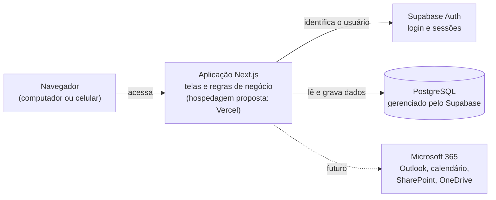
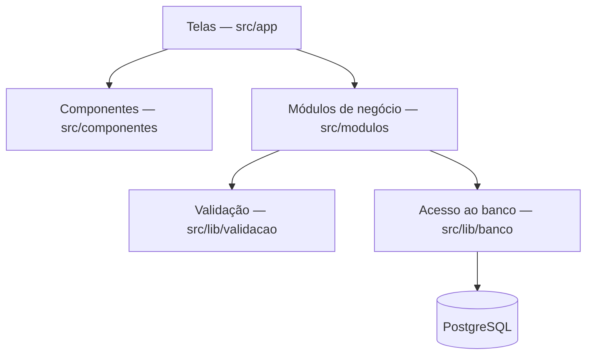

# Arquitetura — CRM Estratégico ES em Ação

| Versão | Data | Situação |
|---|---|---|
| 0.1 | 31/10/2026 | Arquitetura da Etapa 0 para revisão |
| 0.2 | 31/10/2026 | Etapa 1: banco de desenvolvimento (PGlite), acesso a dados (Drizzle ORM) e Cadastro Mestre |
| 0.3 | 01/11/2026 | Revisão de homologação: trava do banco local, proteção de produção e contatos |
| 0.4 | 01/11/2026 | Etapa 1.1: telas de comitês, projetos e temas (módulo `projetos-temas`) |
| 0.5 | 01/11/2026 | Etapa 2A: avaliações estratégicas (módulo `avaliacoes`) e permissões por contexto, ainda não homologadas |
| 0.6 | 01/11/2026 | Repositório público com e-mail *noreply* nos commits (D-039) e proposta de testes no GitHub Actions (P-039) |
| 0.7 | 01/11/2026 | Verificação automática no GitHub Actions implementada (D-041) |

Legenda: ✅ Aprovado · 🔧 Proposta técnica · ⏳ Pendente.

## 1. Visão geral em linguagem simples

O CRM será um **sistema web**: a pessoa usuária acessa pelo navegador, sem instalar nada. Por trás, há três partes:



| Parte | Analogia | Situação após a Etapa 1 |
|---|---|---|
| **Aplicação (Next.js)** | A "recepção" do sistema: mostra as telas, recebe os dados e aplica as regras. | Página inicial e telas do Cadastro Mestre (pessoas, instituições e vínculos). |
| **Banco de dados (PostgreSQL)** | O "arquivo" onde as informações ficam guardadas de forma organizada e segura. | Banco **local de desenvolvimento** (PGlite), com dados fictícios. O Supabase ainda não é usado. |
| **Autenticação (Supabase Auth)** | A "portaria": confere quem é a pessoa e o que ela pode acessar. | Não existe. Operações atribuídas a um administrador fictício. |

Nenhum serviço externo foi conectado. ✅

### 1.1 Banco de dados de desenvolvimento (Etapa 1) ✅ D-018

O PGlite é um PostgreSQL completo que roda dentro da própria aplicação, sem instalar programas. Os dados ficam na pasta `.dados/pglite` do projeto, que **não** vai para o GitHub. Os scripts que criam as tabelas são os mesmos que serão aplicados no Supabase, na etapa de hospedagem.

Cuidados:

- o banco local aceita um processo por vez. **Trava exclusiva** (correção C1): ao abrir o banco, o sistema cria `.dados/pglite.trava` com o número do processo; um segundo programa é recusado com mensagem clara, em vez de perder gravações sem aviso, como a revisão comprovou que ocorria. Travas deixadas por processos já encerrados são substituídas automaticamente. Pare a aplicação antes de rodar `npm run banco:exemplos` ou `npm run banco:reiniciar`;
- **proteção de produção** (correção C3): em modo de produção (`npm start`), o banco local só é aceito com a variável `CRM_BANCO=pglite` (por exemplo, no arquivo `.env.local`), destinada apenas a testes locais da versão compilada;
- **cópia de segurança:** com a aplicação parada, copiar a pasta `.dados/pglite` restaura o banco integralmente; a revisão também testou o arquivo compactado gerado pelo PGlite (`dumpDataDir`). Comandos próprios estão planejados (C7);
- é exclusivo para desenvolvimento e testes, com dados fictícios.

## 2. Tecnologias

### 2.1 Arquitetura de referência ✅

Aprovada como referência, sujeita a validação técnica e institucional (conforme README):

| Tecnologia | Função | Situação |
|---|---|---|
| Next.js com TypeScript | Aplicação web (telas e servidor) | Instalado e em uso |
| PostgreSQL | Banco de dados relacional | Em uso localmente, por meio do PGlite (Etapa 1) |
| Supabase | Gerenciamento do PostgreSQL, autenticação e segurança por linha | Não conectado |
| Supabase Auth | Login de usuários | Não configurado |
| Vercel | Hospedagem proposta | Não utilizada |
| GitHub | Versionamento e revisão (Pull Requests) | Em uso |

### 2.2 Componentes adotados na Etapa 0 🔧

Versões instaladas e testadas em 31/10/2026 (registradas com exatidão no arquivo `package-lock.json`):

| Componente | Versão | Para que serve |
|---|---|---|
| Node.js | 26.13.0 LTS (aceita 22.22+, 24.15+ ou 26+) | Programa que executa a aplicação e as ferramentas |
| Next.js | 16.4.3 | Estrutura da aplicação web |
| React | 19.3.0 | Construção das telas |
| TypeScript | 5.9.3 | Linguagem com verificação de tipos, que reduz erros |
| Tailwind CSS | 4.3.3 | Estilos visuais |
| ESLint (com `eslint-config-next`) | 9.39.5 | Verificação de qualidade do código |
| Zod | 4.6.7 | Validação de dados, com mensagens em português |
| Vitest | 5.0.5 | Execução dos testes automatizados |
| Testing Library (React) | 16.3.3 | Testes das telas como o usuário as vê |
| jsdom | 30.1.3 | Simula um navegador durante os testes |
| PGlite (Etapa 1) | 0.5.13 | Banco PostgreSQL local de desenvolvimento ✅ D-018 |
| Drizzle ORM (Etapa 1) | 0.45.4 | Acesso ao banco em TypeScript, compatível com PGlite e Supabase |
| drizzle-kit (Etapa 1) | 0.31.11 | Gera os scripts SQL de criação e alteração das tabelas |
| tsx (Etapa 1) | 4.23.15 | Executa os scripts de manutenção do banco local |

Critérios de escolha: versões estáveis; combinação gerada pelo instalador oficial do Next.js (`create-next-app` 16.4.3); ferramentas de teste recomendadas na documentação do Next.js. Não foram adotadas versões principais muito recentes (TypeScript 7, ESLint 10) porque o próprio instalador oficial ainda utiliza TypeScript 5 e ESLint 9.

Observações:

- O ESLint 9 exibe aviso de fim de suporte. A migração para o ESLint 10 deve ocorrer quando o `eslint-config-next` passar a adotá-lo oficialmente. 🔧
- A página inicial usa as fontes do próprio sistema operacional, sem baixar fontes da internet durante a compilação. Isso evita dependência de serviço externo. 🔧
- Configurações ativadas pelo instalador oficial e mantidas: *Cache Components* e *Partial Prefetching* (recursos de desempenho do Next.js 16) e o compilador Turbopack. 🔧
- Na Etapa 1 foram usadas as versões estáveis do Drizzle (0.45), e não a 1.0, ainda em fase de candidata. O PGlite foi fixado na versão 0.5.13; a 0.5.14 havia sido publicada no mesmo dia. 🔧
- As telas que leem o banco chamam `connection()` (ver `src/lib/banco/requisicao.ts`), para que o Next.js consulte os dados a cada acesso, e não uma única vez durante a compilação. 🔧

## 3. Camadas e organização das pastas 🔧

```
crm-estrategico-es-em-acao/
├── docs/                     Documentação do projeto
├── scripts/                  Manutenção do banco local (dados fictícios, reinício)
├── src/
│   ├── app/                  Interface: telas (rotas) da aplicação
│   │   ├── layout.tsx        Moldura comum: cabeçalho, menu e rodapé
│   │   ├── page.tsx          Página inicial
│   │   ├── comites/          Lista e detalhe dos comitês (somente consulta)
│   │   ├── projetos-temas/   Projetos e temas; [id]/avaliacoes (fichas e rascunhos) e [id]/matriz
│   │   ├── metodologias/     Consulta das metodologias de avaliação
│   │   ├── pessoas/          Lista, inclusão, detalhe e edição de pessoas
│   │   ├── instituicoes/     Lista, inclusão, detalhe e edição de instituições
│   │   ├── not-found.tsx     Página "não encontrado"
│   │   ├── error.tsx         Página de erro inesperado
│   │   ├── globals.css       Cores e estilos globais
│   │   └── icon.svg          Ícone exibido na aba do navegador
│   ├── componentes/          Componentes visuais reutilizáveis (campos, alertas, selos…)
│   ├── modulos/
│   │   ├── acesso/           Usuário atual (provisório até a autenticação)
│   │   ├── avaliacoes/       Avaliação estratégica: cálculo de demonstração, matriz, consultas, ações e telas
│   │   ├── projetos-temas/   Comitês, projetos, temas e contextos: validações, consultas, ações e componentes
│   │   └── stakeholders/     Cadastro Mestre: validações, consultas, ações e componentes
│   └── lib/
│       ├── banco/            Conexão, estrutura das tabelas e scripts SQL (migracoes/)
│       ├── validacao/        Regras genéricas de validação (inclusive CNPJ)
│       ├── formatacao.ts     Datas no padrão brasileiro
│       └── texto.ts          Normalização de textos para busca
├── testes/                   Testes automatizados
├── drizzle.config.ts         Configuração do gerador de scripts do banco
├── .env.example              Modelo de variáveis de ambiente (sem valores)
├── .gitignore                Arquivos que não vão para o GitHub
├── AGENTS.md                 Orientações do Next.js para assistentes de programação
├── eslint.config.mjs         Regras de qualidade de código
├── next.config.ts            Configuração do Next.js
├── package.json              Lista de bibliotecas e comandos do projeto
├── package-lock.json         Versões exatas das bibliotecas instaladas
├── tsconfig.json             Configuração do TypeScript
└── vitest.config.mts         Configuração dos testes
```

Fluxo entre as camadas (em uso desde a Etapa 1):



Regras de organização:

1. As telas não acessam o banco diretamente: passam pelos módulos de negócio.
2. Toda informação recebida é validada antes de ser gravada.
3. Os componentes reutilizáveis não contêm regras de negócio.
4. Os nomes de pastas de negócio, tabelas e campos ficam em português; as pastas exigidas pelo Next.js (`app`) mantêm o nome padrão.

## 4. Ambientes 🔧

| Ambiente | Finalidade | Dados | Situação |
|---|---|---|---|
| Desenvolvimento local | Construção e testes no computador, com banco PGlite | Fictícios ✅ | Em uso |
| Homologação | Validação pelo gestor e pela equipe técnica, acessível pela internet | Fictícios ✅ | ⏳ Exige contas no Supabase e na Vercel |
| Produção | Uso institucional | Reais, após autorização ✅ | ⏳ |

## 5. Segurança 🔧

| Medida | Situação |
|---|---|
| Nenhuma credencial no código; segredos apenas em variáveis de ambiente (`.env.local`, ignorado pelo Git). | ✅ (regra) / 🔧 (mecanismo) |
| `.env.example` versionado apenas com nomes de variáveis. | 🔧 |
| Controle de acesso no próprio banco (Row Level Security) por projeto ou tema. | 🔧 |
| Comunicação sempre por HTTPS na hospedagem. | 🔧 |
| Trilha de auditoria das alterações, gravada pelo próprio banco e protegida contra alteração. | 🔧 (implementada na Etapa 1) |
| Registros nunca excluídos, apenas arquivados. | 🔧 (implementado na Etapa 1) |
| Trava exclusiva do banco local e proteção contra uso do banco local em produção. | 🔧 (revisão de homologação, C1 e C3) |
| Limites conhecidos da auditoria: responsável informado pela aplicação; `TRUNCATE` não bloqueado; o dono do banco pode desativar gatilhos; cópias integrais de dados pessoais. | ⏳ Reforço planejado (C6) e identificação real na etapa de autenticação |
| Validação de todos os dados no servidor, inclusive endereços de site (somente http e https). | 🔧 (implementado na Etapa 1) |
| Princípio do menor privilégio: cada usuário acessa apenas os contextos de que precisa. | 🔧 |
| Proteção da branch `main` no GitHub. | 🔧 |
| Repositório público (D-033): verificação de dados pessoais, informações restritas e segredos antes de cada envio; e-mail *noreply* do GitHub nos commits a partir de 01/11/2026 (D-039). O histórico anterior não é reescrito sem aprovação. | ✅ |
| Controle de acesso por projeto ou tema nas consultas do servidor, com testes (Etapa 2A). Sem autenticação real nem regras no banco: **segurança multiusuário não homologada**. | 🔧 (D-034) |
| Verificação automática no GitHub Actions a cada Pull Request e atualização da `main`, com permissões mínimas e sem credenciais (seção 6.1). | ✅ (D-041) |

## 6. Comandos do projeto

| Comando | O que faz |
|---|---|
| `npm install` | Instala as bibliotecas listadas no `package.json` |
| `npm run dev` | Executa a aplicação em modo de desenvolvimento (<http://localhost:3000>) |
| `npm run typecheck` | Gera os tipos das rotas e verifica o TypeScript |
| `npm run lint` | Verifica a qualidade do código |
| `npm test` | Executa os testes automatizados uma vez |
| `npm run test:watch` | Executa os testes continuamente durante o desenvolvimento |
| `npm run build` | Compila a aplicação para produção |
| `npm start` | Executa a versão compilada |
| `npm run verificar` | Executa tipos, qualidade, testes e compilação, em sequência |
| `npm run banco:exemplos` | Carrega pessoas, instituições, projetos, temas e avaliações de demonstração fictícios no banco local (com a aplicação parada) |
| `npm run banco:reiniciar` | Apaga o banco local, que é recriado vazio na próxima execução (com a aplicação parada) |
| `npm run banco:gerar` | Gera um novo script SQL após alterar `src/lib/banco/esquema.ts` (uso técnico) |

### 6.1 Verificação automática no GitHub Actions ✅ (D-041)

Arquivo: `.github/workflows/verificacao.yml`. A cada Pull Request e a cada atualização da `main`, o GitHub executa a mesma verificação feita no computador, e o resultado aparece no próprio Pull Request (aba "Checks" e resumo de cada execução):

1. Baixa o código da branch.
2. Instala o Node.js — em duas execuções paralelas, **24 e 26**, as versões LTS aceitas pelo projeto (o desenvolvimento usa a 26).
3. Instala as bibliotecas exatas do `package-lock.json` (`npm ci`, instalação reproduzível).
4. Executa `npm run verificar`: tipos, qualidade (ESLint), testes (Vitest, com banco PGlite na memória e só dados fictícios) e compilação (Next.js).
5. Registra um resumo com o resultado e as versões usadas.

Segurança, conforme o guia oficial do GitHub Actions:

| Prática | Como foi aplicada |
|---|---|
| Permissões mínimas | `contents: read` (somente leitura) |
| Pull Requests de terceiros | Evento `pull_request`, que roda sem segredos e sem permissão de escrita; o `pull_request_target` não é usado |
| Credenciais | Nenhum segredo ou credencial; o checkout não guarda o token no disco (`persist-credentials: false`) |
| Ações de terceiros | Somente ações oficiais (`actions/checkout` v7.0.1 e `actions/setup-node` v7.1.0), fixadas pelo código completo do commit |
| Injeção de comandos | Nenhum dado do evento (título, nome da branch etc.) é usado dentro de comandos |
| Limites | Tempo máximo de 20 minutos; nova atualização do mesmo PR cancela a verificação anterior |
| Publicação e merge | O fluxo não publica a aplicação e não faz merge |

Recomendação ao administrador da conta 🔧: em Settings → Actions → General, exigir aprovação para executar fluxos de Pull Requests de colaboradores externos e, se desejado, proteger a `main` exigindo que a verificação passe antes do merge.

Passo posterior, dependente de Q-57: um segundo teste em PostgreSQL real, para a portabilidade (C8).

## 7. Decisões de arquitetura pendentes ⏳

| ID | Questão |
|---|---|
| Q-50 | Login por e-mail e senha (Supabase Auth) ou por contas Microsoft 365 institucionais (Microsoft Entra ID, também suportado pelo Supabase Auth). |
| Q-51 | Região de hospedagem dos dados. O Supabase oferece região em São Paulo. |
| Q-52 | Transferência dos serviços e do repositório para contas institucionais. |
| Q-57 | Teste de portabilidade em PostgreSQL real (C8). |
| — | Abordagem das integrações com Microsoft 365 (Microsoft Graph) e de IA assistiva. |

Resolvidas na Etapa 1: local da cópia de trabalho (D-019) e ferramenta de banco local (D-018).
