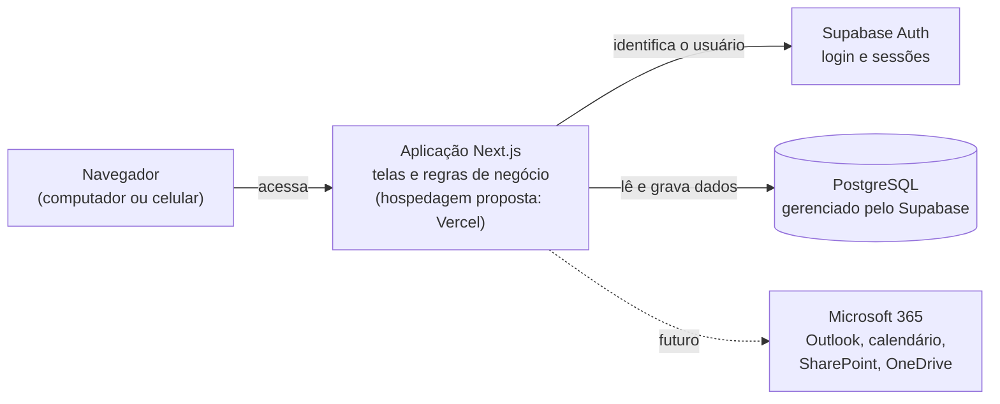
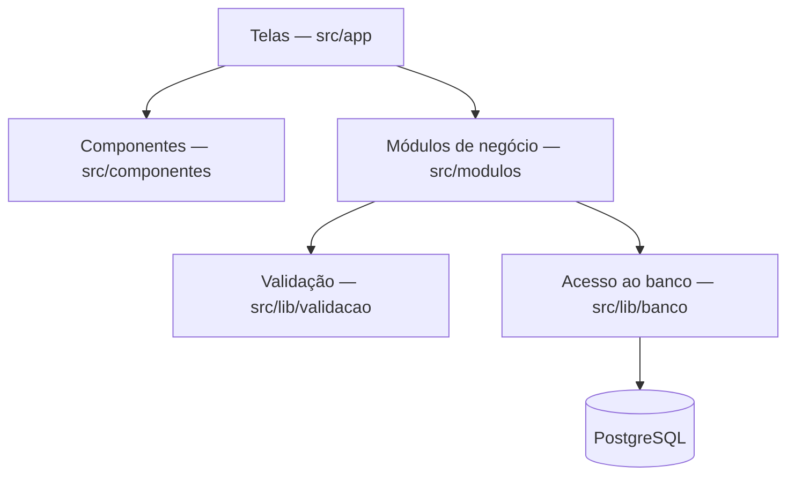

# Arquitetura — CRM Estratégico ES em Ação

| Versão | Data | Situação |
|---|---|---|
| 0.1 | 31/10/2026 | Arquitetura da Etapa 0 para revisão |

Legenda: ✅ Aprovado · 🔧 Proposta técnica · ⏳ Pendente.

## 1. Visão geral em linguagem simples

O CRM será um **sistema web**: a pessoa usuária acessa pelo navegador, sem instalar nada. Por trás, há três partes:



| Parte | Analogia | Na Etapa 0 |
|---|---|---|
| **Aplicação (Next.js)** | A "recepção" do sistema: mostra as telas, recebe os dados e aplica as regras. | Existe apenas a página inicial. |
| **Banco de dados (PostgreSQL)** | O "arquivo" onde as informações ficam guardadas de forma organizada e segura. | Não existe. Apenas o modelo está documentado. |
| **Autenticação (Supabase Auth)** | A "portaria": confere quem é a pessoa e o que ela pode acessar. | Não existe. |

Nenhum serviço externo foi conectado na Etapa 0. ✅

## 2. Tecnologias

### 2.1 Arquitetura de referência ✅

Aprovada como referência, sujeita a validação técnica e institucional (conforme README):

| Tecnologia | Função | Situação na Etapa 0 |
|---|---|---|
| Next.js com TypeScript | Aplicação web (telas e servidor) | Instalado e em uso |
| PostgreSQL | Banco de dados relacional | Modelo documentado; banco não criado |
| Supabase | Gerenciamento do PostgreSQL, autenticação e segurança por linha | Não conectado |
| Supabase Auth | Login de usuários | Não configurado |
| Vercel | Hospedagem proposta | Não utilizada |
| GitHub | Versionamento e revisão (Pull Requests) | Em uso |

### 2.2 Componentes adotados na Etapa 0 🔧

Versões instaladas e testadas em 31/10/2026 (registradas com exatidão no arquivo `package-lock.json`):

| Componente | Versão | Para que serve |
|---|---|---|
| Node.js | 26.13.0 LTS (aceita 22.22+, 24.15+ ou 26+) | Programa que executa a aplicação e as ferramentas |
| Next.js | 16.4.3 | Estrutura da aplicação web |
| React | 19.3.0 | Construção das telas |
| TypeScript | 5.9.3 | Linguagem com verificação de tipos, que reduz erros |
| Tailwind CSS | 4.3.3 | Estilos visuais |
| ESLint (com `eslint-config-next`) | 9.39.5 | Verificação de qualidade do código |
| Zod | 4.6.7 | Validação de dados, com mensagens em português |
| Vitest | 5.0.5 | Execução dos testes automatizados |
| Testing Library (React) | 16.3.3 | Testes das telas como o usuário as vê |
| jsdom | 30.1.3 | Simula um navegador durante os testes |

Critérios de escolha: versões estáveis; combinação gerada pelo instalador oficial do Next.js (`create-next-app` 16.4.3); ferramentas de teste recomendadas na documentação do Next.js. Não foram adotadas versões principais muito recentes (TypeScript 7, ESLint 10) porque o próprio instalador oficial ainda utiliza TypeScript 5 e ESLint 9.

Observações:

- O ESLint 9 exibe aviso de fim de suporte. A migração para o ESLint 10 deve ocorrer quando o `eslint-config-next` passar a adotá-lo oficialmente. 🔧
- A página inicial usa as fontes do próprio sistema operacional, sem baixar fontes da internet durante a compilação. Isso evita dependência de serviço externo. 🔧
- Configurações ativadas pelo instalador oficial e mantidas: *Cache Components* e *Partial Prefetching* (recursos de desempenho do Next.js 16) e o compilador Turbopack. 🔧

## 3. Camadas e organização das pastas 🔧

```
crm-estrategico-es-em-acao/
├── docs/                     Documentação do projeto
├── src/
│   ├── app/                  Interface: telas (rotas) da aplicação
│   │   ├── layout.tsx        Moldura comum a todas as páginas (idioma, título)
│   │   ├── page.tsx          Página inicial
│   │   ├── globals.css       Cores e estilos globais
│   │   └── icon.svg          Ícone exibido na aba do navegador
│   ├── componentes/          Componentes visuais reutilizáveis
│   ├── modulos/              Módulos de negócio (um por funcionalidade; vazios na Etapa 0)
│   └── lib/
│       ├── banco/            Acesso futuro ao banco de dados (sem conexão na Etapa 0)
│       └── validacao/        Regras de validação de dados
├── testes/                   Testes automatizados
├── .env.example              Modelo de variáveis de ambiente (sem valores)
├── .gitignore                Arquivos que não vão para o GitHub
├── AGENTS.md                 Orientações do Next.js para assistentes de programação
├── eslint.config.mjs         Regras de qualidade de código
├── next.config.ts            Configuração do Next.js
├── package.json              Lista de bibliotecas e comandos do projeto
├── package-lock.json         Versões exatas das bibliotecas instaladas
├── tsconfig.json             Configuração do TypeScript
└── vitest.config.mts         Configuração dos testes
```

Fluxo previsto entre as camadas, a partir da Etapa 1:



Regras de organização:

1. As telas não acessam o banco diretamente: passam pelos módulos de negócio.
2. Toda informação recebida é validada antes de ser gravada.
3. Os componentes reutilizáveis não contêm regras de negócio.
4. Os nomes de pastas de negócio, tabelas e campos ficam em português; as pastas exigidas pelo Next.js (`app`) mantêm o nome padrão.

## 4. Ambientes 🔧

| Ambiente | Finalidade | Dados | Situação |
|---|---|---|---|
| Desenvolvimento local | Construção e testes no computador | Fictícios ✅ | Em uso |
| Homologação | Validação pelo gestor e pela equipe técnica, acessível pela internet | Fictícios ✅ | ⏳ Exige contas no Supabase e na Vercel |
| Produção | Uso institucional | Reais, após autorização ✅ | ⏳ |

## 5. Segurança 🔧

| Medida | Situação |
|---|---|
| Nenhuma credencial no código; segredos apenas em variáveis de ambiente (`.env.local`, ignorado pelo Git). | ✅ (regra) / 🔧 (mecanismo) |
| `.env.example` versionado apenas com nomes de variáveis. | 🔧 |
| Controle de acesso no próprio banco (Row Level Security) por projeto ou tema. | 🔧 |
| Comunicação sempre por HTTPS na hospedagem. | 🔧 |
| Trilha de auditoria das alterações. | 🔧 |
| Princípio do menor privilégio: cada usuário acessa apenas os contextos de que precisa. | 🔧 |
| Proteção da branch `main` no GitHub. | 🔧 |

## 6. Comandos do projeto

| Comando | O que faz |
|---|---|
| `npm install` | Instala as bibliotecas listadas no `package.json` |
| `npm run dev` | Executa a aplicação em modo de desenvolvimento (<http://localhost:3000>) |
| `npm run typecheck` | Gera os tipos das rotas e verifica o TypeScript |
| `npm run lint` | Verifica a qualidade do código |
| `npm test` | Executa os testes automatizados uma vez |
| `npm run test:watch` | Executa os testes continuamente durante o desenvolvimento |
| `npm run build` | Compila a aplicação para produção |
| `npm start` | Executa a versão compilada |
| `npm run verificar` | Executa tipos, qualidade, testes e compilação, em sequência |

## 7. Decisões de arquitetura pendentes ⏳

| ID | Questão |
|---|---|
| Q-50 | Login por e-mail e senha (Supabase Auth) ou por contas Microsoft 365 institucionais (Microsoft Entra ID, também suportado pelo Supabase Auth). |
| Q-51 | Região de hospedagem dos dados. O Supabase oferece região em São Paulo. |
| Q-52 | Transferência dos serviços e do repositório para contas institucionais. |
| Q-53 | Local definitivo da cópia de trabalho (fora do Google Drive). |
| — | Ferramenta de banco local para a Etapa 1 (Supabase local com Docker Desktop ou PostgreSQL instalado diretamente). |
| — | Abordagem das integrações com Microsoft 365 (Microsoft Graph) e de IA assistiva. |
