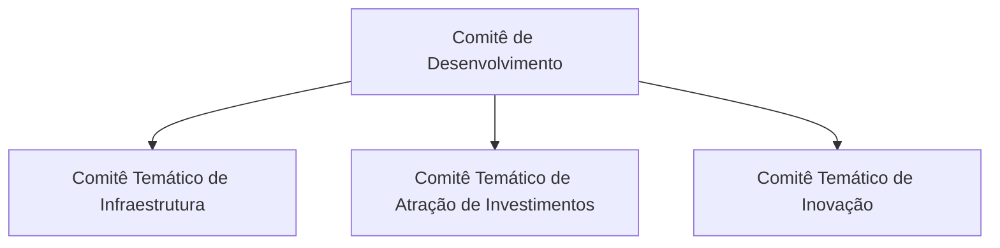

# Governança do Projeto

| Versão | Data | Situação |
|---|---|---|
| 0.1 | 31/10/2026 | Rascunho para revisão |
| 0.2 | 06/11/2026 | Perfis de acesso aprovados (D-074), a implementar na Etapa 5 |
| 0.3 | 06/11/2026 | Perfis implementados na Etapa 5, aguardando homologação: administração de usuários e permissões na tela "Usuários" |
| 0.4 | 06/11/2026 | Etapa 5 homologada para desenvolvimento (D-078) |
| 0.5 | 07/11/2026 | Etapa 6 homologada para desenvolvimento (D-080): painéis e exportações por perfil (D-079) |

Legenda: ✅ Aprovado · 🔧 Proposta técnica · ⏳ Pendente.

## 1. Estrutura institucional atendida ✅

## 2. Papéis no projeto

| Papel | Responsabilidade | Situação |
|---|---|---|
| **Gestor do projeto** | Define requisitos, aprova cada etapa, revisa e aprova os Pull Requests, decide as questões pendentes. | ✅ |
| **Administrador do sistema** | Operador único do CRM na fase inicial; concede permissões quando houver novos usuários. | ✅ |
| **Desenvolvimento assistido** | O código é produzido com apoio do Claude Code, sob supervisão do gestor, sempre em branch separada e com Pull Request. | ✅ |
| **Validação técnica** | Revisão técnica independente da arquitetura e da segurança antes do uso com dados reais. | 🔧 ⏳ (quem fará) |
| **Validação institucional** | Aprovação formal do ES em Ação para hospedagem, uso de dados reais e titularidade. | ✅ (prevista no README) ⏳ (responsável) |
| **Encarregado de dados (LGPD)** | Orientação sobre tratamento de dados pessoais de stakeholders. | ⏳ |

## 3. Perfis de acesso ao sistema ✅ (D-074)

| Perfil | Escopo | O que pode fazer |
|---|---|---|
| Administrador | Todo o sistema | Controle integral, inclusive administração de usuários e permissões e metodologia |
| Gestor | Projetos e temas sob sua responsabilidade | Consulta, registra, altera e aprova versões de planos de ação |
| Colaborador | Projetos e temas autorizados | Consulta, registra e altera, sem aprovar versões |
| Leitor | Projetos e temas autorizados | Consulta exclusivamente as informações autorizadas |

Não há outras categorias de perfil. O diretório básico do Cadastro Mestre é consultado por todos os usuários ativos e autenticados; os dados restritos seguem o [Plano de Implantação](PLANO_IMPLANTACAO.md), seção 10.

**Painéis e exportações (D-079; homologados para desenvolvimento, D-080):** todos os perfis consultam os painéis dentro de seu acesso. Administrador, gestor e colaborador exportam relatórios pelo CRM, cada um dentro de seus projetos e temas; avaliações nominais de stakeholders, só administrador e gestor do projeto ou tema. O leitor não tem exportação pelo CRM, regra que não impede capturas ou impressões feitas pelo próprio navegador.

Inicialmente existirá apenas o Administrador. ✅ As permissões são concedidas por projeto ou tema. ✅

Na Etapa 2A foram criadas a tabela de permissões por contexto e as verificações no servidor, com testes de autorização (D-034). **A segurança multiusuário ainda não foi homologada**: não há autenticação real (Etapa 5) nem regras de segurança no próprio banco de dados.

## 4. Titularidade provisória ✅

Conforme o README:

- O repositório é administrado provisoriamente em conta pessoal, para desenvolvimento e testes.
- Está prevista a transferência para conta institucional do ES em Ação, mediante autorização e formalização.
- A titularidade definitiva do código, os direitos de uso e as responsabilidades institucionais deverão ser formalmente definidos. A declaração do README não constitui transferência automática de direitos.

## 5. Segurança ✅

- O repositório é mantido **público** por decisão do gestor (D-033, de 01/11/2026, que substitui a exigência de repositório privado da D-007), com ciência dos riscos. Não podem ser publicados: informações reais de stakeholders, documentos internos, planilhas institucionais, senhas, tokens, credenciais, dados de produção ou informações confidenciais. ✅
- Antes de cada envio ao GitHub, verificar os arquivos adicionados ou modificados e o histórico relevante, procurando dados pessoais, informações institucionais restritas e segredos. ✅
- O código público não torna público o banco de dados do CRM, que terá acesso restrito. ✅
- Os commits passam a usar o endereço *noreply* do GitHub, que não expõe o e-mail pessoal (D-039). O histórico já publicado não é reescrito sem aprovação do gestor. ✅
- É **proibido** armazenar senhas, tokens, chaves de acesso ou outras credenciais no código-fonte. Configurações sensíveis ficarão em variáveis de ambiente, fora do repositório; o arquivo `.env.example` lista apenas os nomes, sem valores. 🔧
- Alterações devem ser **documentadas e testadas** antes da implantação.

## 6. Dados ✅ / ⏳

| Regra | Situação |
|---|---|
| Ambiente de testes usa exclusivamente dados fictícios. | ✅ |
| Uso de dados institucionais reais somente após autorização formal. | ✅ |
| Base legal (LGPD) para o tratamento de dados pessoais de stakeholders. | ⏳ |
| Política de retenção e de exclusão de dados pessoais. | ⏳ |
| Atendimento a pedidos de titulares (acesso, correção, exclusão). | ⏳ |
| Região de armazenamento dos dados. | ⏳ |

## 7. Fluxo de trabalho no GitHub ✅

Explicado sem jargões:

| Termo | O que é |
|---|---|
| **Repositório** | Pasta do projeto guardada no GitHub, com todo o histórico de alterações. |
| **Branch** ("ramo") | Cópia paralela do projeto onde se trabalha sem afetar a versão principal. |
| **`main`** | Branch principal, que representa a versão aprovada do sistema. |
| **Commit** | Registro de um conjunto de alterações, com autor, data e descrição. |
| **Pull Request (PR)** | Pedido para incorporar uma branch à `main`. É onde o gestor revisa as mudanças, comenta e aprova. |
| **Merge** ("incorporação") | Ato de juntar a branch aprovada à `main`. |

Regras:

1. Não se trabalha diretamente na branch `main`. ✅
2. Cada etapa ou funcionalidade tem sua própria branch (por exemplo, `feature/fundacao-crm`). ✅
3. Ao final, abre-se um Pull Request para revisão. ✅
4. A incorporação à `main` só ocorre com aprovação do gestor; nunca automaticamente. ✅
5. Não se avança para a etapa seguinte sem aprovação. ✅
6. Antes de abrir o Pull Request, as verificações automáticas (tipos, qualidade, testes e compilação) devem ser executadas e seus resultados informados. ✅ (testes antes da implantação) / 🔧 (forma)
7. Recomenda-se proteger a branch `main` no GitHub (Settings → Branches), exigindo Pull Request para qualquer alteração. 🔧

## 8. Gestão de mudanças 🔧

- Toda decisão relevante é registrada em [REGISTRO_DECISOES.md](REGISTRO_DECISOES.md), com data, situação e justificativa.
- Mudanças na metodologia de avaliação geram nova versão da metodologia, sem alterar avaliações já registradas.
- Mudanças no plano de ação seguem o fluxo de versões e aprovação descrito em [PLANO_ACAO.md](PLANO_ACAO.md).
