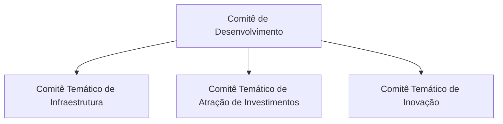

# Governança do Projeto

| Versão | Data | Situação |
|---|---|---|
| 0.1 | 31/10/2026 | Rascunho para revisão |

Legenda: ✅ Aprovado · 🔧 Proposta técnica · ⏳ Pendente.

## 1. Estrutura institucional atendida ✅

## 2. Papéis no projeto

| Papel | Responsabilidade | Situação |
|---|---|---|
| **Gestor do projeto** | Define requisitos, aprova cada etapa, revisa e aprova os Pull Requests, decide as questões pendentes. | ✅ |
| **Administrador do sistema** | Operador único do CRM na fase inicial; concede permissões quando houver novos usuários. | ✅ |
| **Desenvolvimento assistido** | O código é produzido com apoio do Claude Code, sob supervisão do gestor, sempre em branch separada e com Pull Request. | ✅ |
| **Validação técnica** | Revisão técnica independente da arquitetura e da segurança antes do uso com dados reais. | 🔧 ⏳ (quem fará) |
| **Validação institucional** | Aprovação formal do ES em Ação para hospedagem, uso de dados reais e titularidade. | ✅ (prevista no README) ⏳ (responsável) |
| **Encarregado de dados (LGPD)** | Orientação sobre tratamento de dados pessoais de stakeholders. | ⏳ |

## 3. Perfis de acesso ao sistema 🔧

| Perfil | Escopo | O que pode fazer |
|---|---|---|
| Administrador | Todo o sistema | Tudo, inclusive gerenciar usuários, permissões e metodologia |
| Gestor de contexto | Projetos/temas em que tem permissão | Registrar e alterar dados do contexto e aprovar alterações de plano ⏳ |
| Colaborador | Projetos/temas em que tem permissão | Registrar interações, avaliações e acompanhamentos |
| Leitor | Projetos/temas em que tem permissão | Somente consulta |

Inicialmente existirá apenas o Administrador. ✅ As permissões são concedidas por projeto ou tema. ✅

## 4. Titularidade provisória ✅

Conforme o README:

- O repositório é administrado provisoriamente em conta pessoal, para desenvolvimento e testes.
- Está prevista a transferência para conta institucional do ES em Ação, mediante autorização e formalização.
- A titularidade definitiva do código, os direitos de uso e as responsabilidades institucionais deverão ser formalmente definidos. A declaração do README não constitui transferência automática de direitos.

## 5. Segurança ✅

- O repositório deve permanecer **privado**.
- É **proibido** armazenar senhas, tokens, chaves de acesso ou outras credenciais no código-fonte. Configurações sensíveis ficarão em variáveis de ambiente, fora do repositório; o arquivo `.env.example` lista apenas os nomes, sem valores. 🔧
- Alterações devem ser **documentadas e testadas** antes da implantação.

## 6. Dados ✅ / ⏳

| Regra | Situação |
|---|---|
| Ambiente de testes usa exclusivamente dados fictícios. | ✅ |
| Uso de dados institucionais reais somente após autorização formal. | ✅ |
| Base legal (LGPD) para o tratamento de dados pessoais de stakeholders. | ⏳ |
| Política de retenção e de exclusão de dados pessoais. | ⏳ |
| Atendimento a pedidos de titulares (acesso, correção, exclusão). | ⏳ |
| Região de armazenamento dos dados. | ⏳ |

## 7. Fluxo de trabalho no GitHub ✅

Explicado sem jargões:

| Termo | O que é |
|---|---|
| **Repositório** | Pasta do projeto guardada no GitHub, com todo o histórico de alterações. |
| **Branch** ("ramo") | Cópia paralela do projeto onde se trabalha sem afetar a versão principal. |
| **`main`** | Branch principal, que representa a versão aprovada do sistema. |
| **Commit** | Registro de um conjunto de alterações, com autor, data e descrição. |
| **Pull Request (PR)** | Pedido para incorporar uma branch à `main`. É onde o gestor revisa as mudanças, comenta e aprova. |
| **Merge** ("incorporação") | Ato de juntar a branch aprovada à `main`. |

Regras:

1. Não se trabalha diretamente na branch `main`. ✅
2. Cada etapa ou funcionalidade tem sua própria branch (por exemplo, `feature/fundacao-crm`). ✅
3. Ao final, abre-se um Pull Request para revisão. ✅
4. A incorporação à `main` só ocorre com aprovação do gestor; nunca automaticamente. ✅
5. Não se avança para a etapa seguinte sem aprovação. ✅
6. Antes de abrir o Pull Request, as verificações automáticas (tipos, qualidade, testes e compilação) devem ser executadas e seus resultados informados. ✅ (testes antes da implantação) / 🔧 (forma)
7. Recomenda-se proteger a branch `main` no GitHub (Settings → Branches), exigindo Pull Request para qualquer alteração. 🔧

## 8. Gestão de mudanças 🔧

- Toda decisão relevante é registrada em [REGISTRO_DECISOES.md](REGISTRO_DECISOES.md), com data, situação e justificativa.
- Mudanças na metodologia de avaliação geram nova versão da metodologia, sem alterar avaliações já registradas.
- Mudanças no plano de ação seguem o fluxo de versões e aprovação descrito em [PLANO_ACAO.md](PLANO_ACAO.md).
