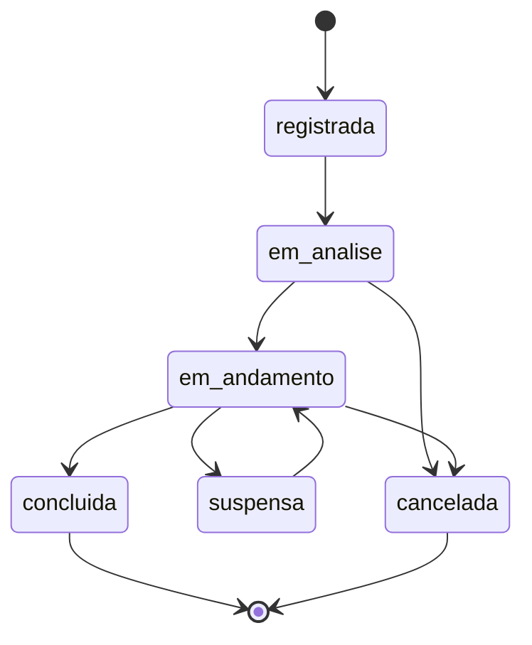

# Matriz de Iniciativas

| Versão | Data | Situação |
|---|---|---|
| 0.1 | 31/10/2026 | Rascunho para revisão |

Legenda: ✅ Aprovado · 🔧 Proposta técnica · ⏳ Pendente.

## 1. Definição ✅

A Matriz de Iniciativas reúne, com **cadastro manual**, as frentes de trabalho do ES em Ação:

| Tipo | Exemplo ilustrativo (fictício) |
|---|---|
| **Demanda** | Pedido de apoio de uma associação municipal para destravar uma licença. |
| **Reunião relevante** | Encontro estratégico que merece acompanhamento próprio, como uma rodada com investidores. |
| **Frente de atuação** | Linha de trabalho contínua, como a articulação para a ampliação de um porto. |

## 2. Regras aprovadas ✅

1. Uma iniciativa pode envolver **vários stakeholders** e **vários projetos ou temas**.
2. Uma interação (reunião, contato) pode contribuir para **uma ou mais iniciativas**.
3. **Reuniões não são registradas em duplicidade.**
4. O cadastro de iniciativas é manual nesta fase.

## 3. Como evitar a duplicidade de reuniões 🔧 ⏳

O registro de uma reunião (data, horário, local, participantes, resumo e encaminhamentos) existe uma única vez, no módulo de **Interações**. A iniciativa se liga a ela, sem copiar os dados.

- Uma iniciativa do tipo **reunião relevante** representa o *assunto acompanhado*; o encontro em si é uma interação ligada a ela.
- Se a mesma reunião tratou de três iniciativas, ela é ligada às três, com um campo opcional descrevendo a contribuição para cada uma.
- No futuro, reuniões importadas do Outlook terão o identificador do evento de origem, impedindo que a mesma reunião entre duas vezes.

⏳ Validar se essa interpretação de "reunião relevante" corresponde à prática da equipe.

## 4. Informações de cada iniciativa 🔧

| Informação | Obrigatória | Observação |
|---|---|---|
| Tipo | Sim | Demanda, reunião relevante ou frente de atuação ✅ |
| Título | Sim | |
| Descrição | Não | |
| Origem | Não | Quem ou o que originou a iniciativa |
| Projetos ou temas | Sim (pelo menos um) | Definem quem pode ver a iniciativa |
| Stakeholders e seus papéis | Não | Papéis propostos: demandante, apoiador, decisor, executor, afetado, outro |
| Responsável interno | Não | |
| Situação | Sim | Ver seção 5 |
| Prioridade | Não | Escala ⏳ |
| Datas | Abertura obrigatória; previsão e conclusão opcionais | |

## 5. Ciclo de vida proposto 🔧

## 6. Relação com outros módulos

| Módulo | Relação |
|---|---|
| Interações | Uma interação contribui para uma ou mais iniciativas ✅ |
| Compromissos | Encaminhamentos podem estar ligados a uma iniciativa 🔧 |
| Plano de Ação | Uma ação do plano pode ter sido originada por uma iniciativa 🔧 |
| Riscos | Um risco pode estar associado a uma iniciativa 🔧 |
| Avaliações | Iniciativas e suas interações podem servir de evidência para avaliações de stakeholders 🔧 |

## 7. Apresentação da matriz ⏳

Ainda não está definido o que a "matriz" mostra nas linhas e nas colunas. Possibilidades para discussão:

- iniciativas × projetos e temas;
- iniciativas × comitês;
- iniciativas × stakeholders envolvidos;
- lista com filtros por tipo, situação, comitê, projeto, responsável e prazo.

## 8. Questões pendentes ⏳

| ID | Questão |
|---|---|
| Q-20 | Formato de apresentação da matriz (seção 7). |
| Q-21 | Escala de prioridade das iniciativas. |
| Q-22 | Validação da interpretação de "reunião relevante" (seção 3). |
| Q-23 | Papéis de stakeholder na iniciativa: a lista proposta atende? |
| Q-24 | Toda iniciativa precisa estar ligada a pelo menos um projeto ou tema? |
