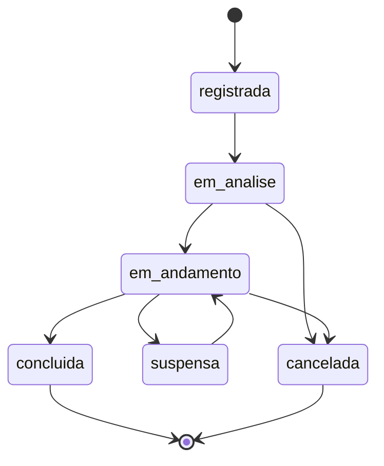

# Matriz de Iniciativas

| Versão | Data | Situação |
|---|---|---|
| 0.1 | 31/10/2026 | Rascunho para revisão |
| 0.2 | 03/11/2026 | Etapa 3 implementada (D-070), aguardando homologação: Q-22 resolvida; soluções provisórias para Q-20, Q-21, Q-23 e Q-24 (P-040 a P-046) |
| 0.3 | 03/11/2026 | Etapa 3 homologada para desenvolvimento (D-071); as soluções provisórias P-040 a P-046 continuam não homologadas |

Legenda: ✅ Aprovado · 🔧 Proposta técnica · ⏳ Pendente.

## 1. Definição ✅

A Matriz de Iniciativas reúne, com **cadastro manual**, as frentes de trabalho do ES em Ação:

| Tipo | Exemplo ilustrativo (fictício) |
|---|---|
| **Demanda** | Pedido de apoio de uma associação municipal para destravar uma licença. |
| **Reunião relevante** | Encontro estratégico que merece acompanhamento próprio, como uma rodada com investidores. |
| **Frente de atuação** | Linha de trabalho contínua, como a articulação para a ampliação de um porto. |

## 2. Regras aprovadas ✅

1. Uma iniciativa pode envolver **vários stakeholders** e **vários projetos ou temas**.
2. Uma interação (reunião, contato) pode contribuir para **uma ou mais iniciativas**.
3. **Reuniões não são registradas em duplicidade.**
4. O cadastro de iniciativas é manual nesta fase.

## 3. Como evitar a duplicidade de reuniões ✅ (D-070; implementado na Etapa 3)

O registro de uma reunião (data, horário, local, participantes, resumo e encaminhamentos) existe uma única vez, no módulo de **Interações**. A iniciativa se liga a ela, sem copiar os dados.

- Uma iniciativa do tipo **reunião relevante** representa o *assunto acompanhado*; o encontro em si é uma interação ligada a ela.
- Se a mesma reunião tratou de três iniciativas, ela é ligada às três, com um campo opcional descrevendo a contribuição para cada uma.
- No futuro, reuniões importadas do Outlook terão o identificador do evento de origem, impedindo que a mesma reunião entre duas vezes.

✅ Interpretação confirmada pelo gestor (D-070). Na Etapa 3, a reunião é registrada uma única vez, já com todas as iniciativas para as quais contribuiu (e a contribuição de cada uma); um alerta aponta interação com assunto igual ou semelhante em data próxima, antes de gravar; a origem de calendário externo é única no banco.

## 4. Informações de cada iniciativa 🔧

| Informação | Obrigatória | Observação |
|---|---|---|
| Tipo | Sim | Demanda, reunião relevante ou frente de atuação ✅ |
| Título | Sim | |
| Descrição | Não | |
| Origem | Não | Quem ou o que originou a iniciativa |
| Projetos ou temas | Sim (pelo menos um) | Definem quem pode ver a iniciativa (provisório, P-043; garantido no banco) |
| Stakeholders e seus papéis | Não | Papéis provisórios (P-042): demandante, apoiador, decisor, executor, afetado, outro; o mesmo stakeholder pode ter mais de um |
| Responsável interno | Não | |
| Situação | Sim | Ver seção 5 |
| Prioridade | Não | Alta, Média ou Baixa (provisória, P-041) |
| Datas | Abertura obrigatória; previsão e conclusão opcionais | |

## 5. Ciclo de vida proposto 🔧

Na Etapa 3, as seis situações foram implementadas sem transições obrigatórias: qualquer mudança é permitida e fica no histórico; a conclusão exige data (provisório, P-044).

## 6. Relação com outros módulos

| Módulo | Relação |
|---|---|
| Interações | Uma interação contribui para uma ou mais iniciativas ✅ (implementado na Etapa 3) |
| Compromissos | Encaminhamentos ligados à interação de origem e/ou a uma iniciativa, com responsável, prazo e acompanhamento ✅ (Etapa 3; P-045) |
| Plano de Ação | Uma ação do plano pode ter sido originada por uma iniciativa 🔧 |
| Riscos | Um risco pode estar associado a uma iniciativa 🔧 |
| Avaliações | Iniciativas e suas interações podem servir de evidência para avaliações de stakeholders 🔧 |

## 7. Apresentação da matriz ⏳

Ainda não está definido o que a "matriz" mostra nas linhas e nas colunas. Possibilidades para discussão:

- iniciativas × projetos e temas;
- iniciativas × comitês;
- iniciativas × stakeholders envolvidos;
- lista com filtros por tipo, situação, comitê, projeto, responsável e prazo.

Solução provisória em uso na Etapa 3 (P-040): lista com filtros por tipo, situação (inclusive "em curso"), comitê, projeto ou tema, responsável, prioridade e título, mostrando projetos, comitês, responsável, situação, interações e compromissos pendentes. O formato definitivo continua pendente (Q-20).

## 8. Questões pendentes ⏳

| ID | Questão |
|---|---|
| Q-20 | Formato de apresentação da matriz (seção 7). Provisório: lista filtrável (P-040). |
| Q-21 | Escala de prioridade das iniciativas. Provisório: Alta, Média, Baixa (P-041). |
| Q-22 | ✅ Resolvida (D-070): "reunião relevante" é o assunto acompanhado; o encontro é registrado uma única vez em Interações. |
| Q-23 | Papéis de stakeholder na iniciativa: a lista proposta atende? Provisório: lista proposta, em uso (P-042). |
| Q-24 | Toda iniciativa precisa estar ligada a pelo menos um projeto ou tema? Provisório: sim (P-043). |
