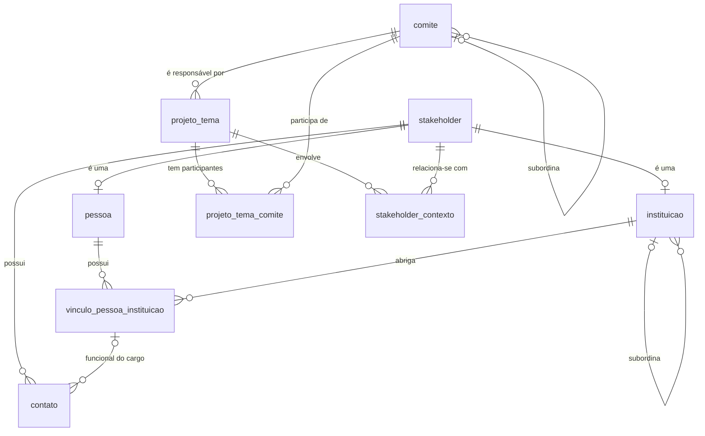
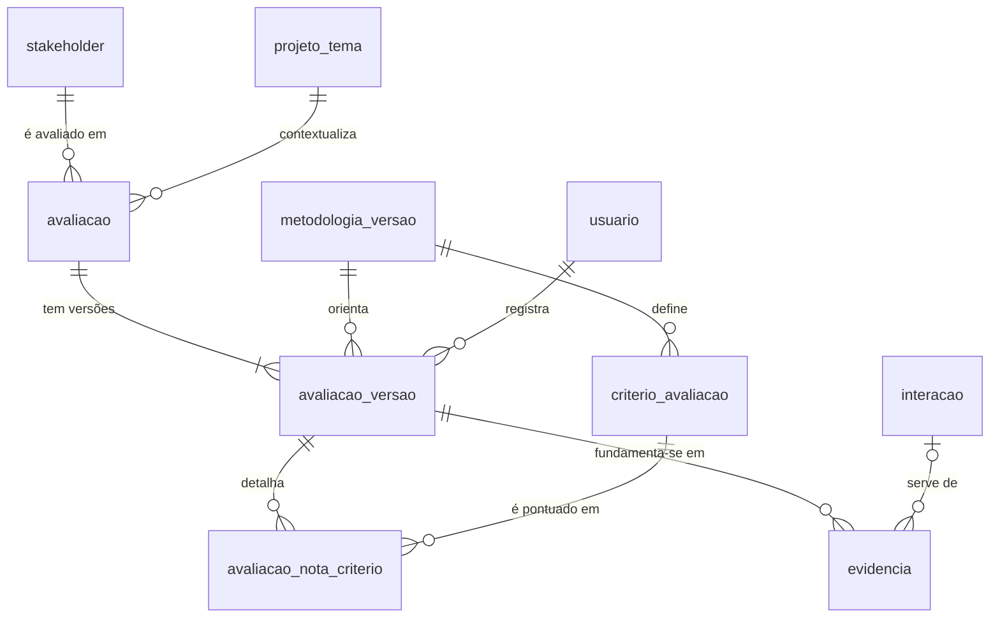
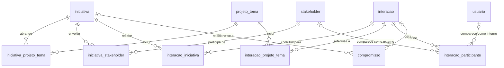
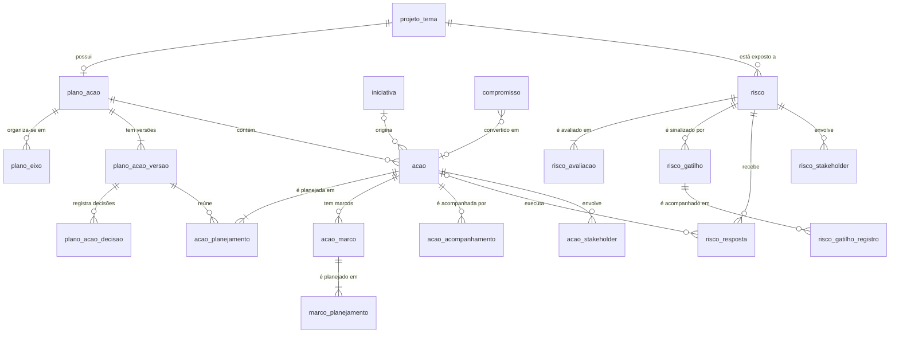
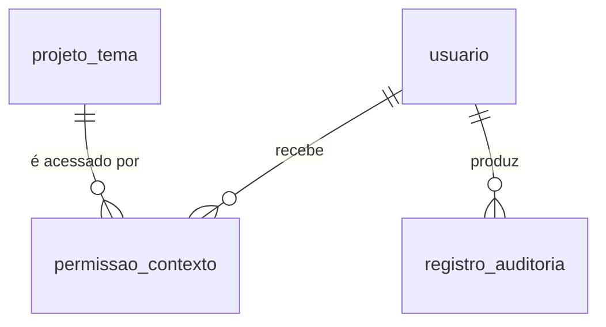

# Modelo de Dados — CRM Estratégico ES em Ação

| Versão | Data | Situação |
|---|---|---|
| 0.1 | 31/10/2026 | Modelo lógico inicial para revisão. Nenhuma tabela foi criada. |
| 0.2 | 31/10/2026 | Etapa 1: decisões D-020 e D-021 incorporadas; as 8 tabelas da seção 9 foram criadas no banco de desenvolvimento. |
| 0.3 | 01/11/2026 | Revisão de homologação: contatos em tabela própria (D-025), país e CNPJ sem unicidade (D-024), comitês participantes previstos (D-023). |
| 0.4 | 01/11/2026 | Etapa 1.1: tabelas `projeto_tema_comite` (D-023) e `stakeholder_contexto` (D-030) criadas; nome normalizado em `projeto_tema`. |
| 0.5 | 01/11/2026 | Etapa 2A: tabelas de avaliação (seção 6.3) e `permissao_contexto` criadas, com metodologias de demonstração (D-034). |
| 0.6 | 01/11/2026 | Escalas V2.2 (D-058 a D-060): adaptação prevista na seção 6.3.1, não implementada (Q-67). |
| 0.7 | 01/11/2026 | Seção 6.3.1: ressalvas relevantes, justificativas e evidências por dimensão (D-061), previstas e não implementadas. |
| 0.8 | 02/11/2026 | Seção 6.3.1 conforme a D-063: ressalvas em três situações, verificação documental, evidência reaproveitada com confirmação e equivalência entre metodologias. Não implementado. |
| 0.9 | 02/11/2026 | Seção 6.3.1: natureza das alterações da metodologia (substantiva ou editorial), conforme a D-064. Não implementado. |
| 0.10 | 02/11/2026 | Seção 6.3.1 e campo `validacao_institucional` conforme a D-067: evidências opcionais, natureza da informação e indicação de não confirmada; regras interpretativas como alertas; bloqueios só técnicos. Não implementado. |
| 0.11 | 02/11/2026 | Seção 6.3.1 conforme a versão final da Q-67 (D-068): natureza da informação do posicionamento e alertas mantidos; retirados a tabela de evidência por dimensão, o tipo "verificação documental" e a confirmação de pertinência. Não implementado. |
| 0.12 | 02/11/2026 | Etapa 2B (D-069): seção 6.3.1 implementada pela migração `0006`, aguardando homologação; `rubrica_nivel` com critério orientador e bases típicas; cópia de segurança antes de atualizações pendentes. |
| 0.13 | 03/11/2026 | Etapa 3 (D-070): seções 6.4 e 6.5 implementadas pela migração `0007`, aguardando homologação; nova tabela `compromisso_acompanhamento`; ligações com identificador próprio e arquivamento; soluções provisórias P-040 a P-046. |
| 0.14 | 03/11/2026 | Etapa 3 homologada para desenvolvimento (D-071); as soluções provisórias P-040 a P-046 continuam não homologadas. |
| 0.15 | 03/11/2026 | Etapa 4 (D-072): seções 6.6 e 6.7 implementadas pela migração `0008`, aguardando homologação; um plano por projeto ou tema; pilares ou eixos (`plano_eixo`); marcos como itens da ação (`acao_marco`, `marco_planejamento`); decisões do fluxo de aprovação (`plano_acao_decisao`); avaliações inerente e residual com criticidade e classificação calculadas pelo banco conforme a matriz original; acompanhamento dos gatilhos; `compromisso.acao_id`. |
| 0.16 | 04/11/2026 | Etapa 4 homologada para desenvolvimento (D-073); as soluções provisórias P-047 a P-053 continuam não homologadas. |

Legenda: ✅ Aprovado · 🔧 Proposta técnica · ⏳ Pendente (ver [REQUISITOS.md](REQUISITOS.md#como-ler-este-documento)).

## 1. Para quem não é da área técnica

Um banco de dados relacional organiza as informações em **tabelas**, como planilhas. Cada tabela guarda um tipo de coisa (pessoas, instituições, reuniões) e cada linha é um registro.

- **Chave primária (PK)**: o "número de identidade" de cada linha. Nunca se repete e nunca muda.
- **Chave estrangeira (FK)**: um campo que aponta para a chave primária de outra tabela. É assim que uma reunião "sabe" quais pessoas participaram, sem copiar os dados dessas pessoas.
- **Cardinalidade**: quantos registros de um lado se ligam a quantos do outro. "1:N" (um para muitos) significa, por exemplo, que um comitê tem muitos projetos, mas cada projeto tem um comitê responsável. "N:N" (muitos para muitos) significa que uma iniciativa envolve vários stakeholders e cada stakeholder participa de várias iniciativas; nesse caso usa-se uma **tabela de ligação**.
- **Regra de integridade**: uma restrição que o próprio banco de dados garante, impedindo dados incoerentes (por exemplo, um prazo final anterior ao inicial).

Os diagramas abaixo são desenhados automaticamente pelo GitHub. Nos diagramas, `||` significa "exatamente um", `o|` "zero ou um", `o{` "zero ou mais" e `|{` "um ou mais".

## 2. Princípios do modelo

| # | Princípio | Situação |
|---|---|---|
| P1 | O Cadastro Mestre é global: cada pessoa e cada instituição existe uma única vez. | ✅ |
| P2 | Pessoas e instituições são cadastros separados, ligados por vínculos com período. | ✅ |
| P3 | Avaliações pertencem a um par **stakeholder × projeto/tema**, são independentes entre si e versionadas. | ✅ |
| P4 | A visibilidade das avaliações (e dos demais registros de contexto) é definida pelo projeto/tema. | ✅ |
| P5 | Cada reunião é registrada uma única vez (`interacao`) e ligada a quantas iniciativas, projetos e participantes forem necessários. | ✅ |
| P6 | Critérios de poder e interesse ficam em tabelas configuráveis, sem conteúdo definido até a revisão dos seis critérios históricos. | ✅ (estrutura 🔧) |
| P7 | "Stakeholder" é um conceito único que engloba pessoa e instituição (tabela-mãe `stakeholder`), para que avaliações, iniciativas e interações apontem para um único lugar. | 🔧 |
| P8 | Versões registradas não são editadas; mudanças geram nova versão. | 🔧 |
| P9 | Registros não são apagados fisicamente: são arquivados (`arquivado_em`). Toda alteração fica em trilha de auditoria. | 🔧 |
| P10 | Chaves primárias do tipo UUID (identificador aleatório de 128 bits), compatível com Supabase e com integrações futuras. | 🔧 |
| P11 | Nomes de tabelas e campos em português, sem acentos, em minúsculas e com sublinhado (`snake_case`). | 🔧 |

## 3. Visão geral por áreas

| Área | Tabelas |
|---|---|
| Estrutura institucional | `comite`, `projeto_tema` |
| Cadastro Mestre | `stakeholder`, `pessoa`, `instituicao`, `vinculo_pessoa_instituicao` |
| Avaliações | `metodologia_versao`, `criterio_avaliacao`, `avaliacao`, `avaliacao_versao`, `avaliacao_nota_criterio`, `evidencia` |
| Iniciativas | `iniciativa`, `iniciativa_projeto_tema`, `iniciativa_stakeholder` |
| Interações e compromissos | `interacao`, `interacao_participante`, `interacao_iniciativa`, `interacao_projeto_tema`, `compromisso`, `compromisso_acompanhamento` |
| Plano de ação | `plano_acao`, `plano_acao_versao`, `acao`, `acao_planejamento`, `acao_acompanhamento` |
| Riscos | `risco`, `risco_avaliacao`, `risco_gatilho`, `risco_resposta`, `risco_stakeholder` |
| Acesso e auditoria | `usuario`, `permissao_contexto`, `registro_auditoria` |

## 4. Diagramas

### 4.1 Estrutura institucional e Cadastro Mestre

### 4.2 Avaliações de stakeholders

### 4.3 Iniciativas, interações e compromissos

### 4.4 Plano de ação e riscos

### 4.5 Acesso

## 5. Campos comuns 🔧

Salvo indicação em contrário, toda tabela principal possui os campos abaixo, que não são repetidos nas seções seguintes.

| Campo | Tipo | Regra |
|---|---|---|
| `id` | UUID | PK, gerado automaticamente |
| `criado_em` | data e hora com fuso | Obrigatório, preenchido automaticamente |
| `criado_por` | UUID | FK → `usuario.id` |
| `atualizado_em` | data e hora com fuso | Atualizado automaticamente a cada alteração |
| `atualizado_por` | UUID | FK → `usuario.id` |
| `arquivado_em` | data e hora com fuso | Nulo enquanto ativo; preenchido ao arquivar |

Tabelas de versão (`avaliacao_versao`, `plano_acao_versao`, `risco_avaliacao`) e tabelas de ligação não têm `atualizado_*` nem `arquivado_em`, pois não são editadas: são incluídas ou, no caso das ligações, removidas com registro na auditoria.

## 6. Entidades

Convenções das tabelas: **PK** = chave primária; **FK** = chave estrangeira; **UK** = valor único; **Obr.** = preenchimento obrigatório.

### 6.1 Estrutura institucional

#### `comite`

Comitês do ES em Ação. ✅ (estrutura) / 🔧 (campos)

| Campo | Tipo | Chave | Obr. | Observação |
|---|---|---|---|---|
| `nome` | texto | UK | Sim | Ex.: "Comitê Temático de Inovação" |
| `sigla` | texto | UK | Não | |
| `tipo` | lista: `desenvolvimento`, `tematico` | | Sim | |
| `comite_superior_id` | UUID | FK → `comite.id` | Não | Comitê ao qual está subordinado |

Cardinalidade: um comitê subordina zero ou mais comitês (1:N, autorrelacionamento).

Regras de integridade:
- Comitê `tematico` deve ter `comite_superior_id` apontando para um comitê `desenvolvimento`. ✅ (subordinação ao Comitê de Desenvolvimento)
- Comitê `desenvolvimento` não tem comitê superior. 🔧
- Um comitê não pode ser superior de si mesmo. 🔧

Carga inicial prevista (quando o banco for criado): Comitê de Desenvolvimento; Comitês Temáticos de Infraestrutura, de Atração de Investimentos e de Inovação. ✅

#### `projeto_tema`

Projetos e temas estratégicos, que são os **contextos** das avaliações e das permissões. Projetos e temas ficam na mesma tabela, diferenciados pelo campo `tipo`, para que avaliações e permissões apontem para um único lugar. 🔧

| Campo | Tipo | Chave | Obr. | Observação |
|---|---|---|---|---|
| `tipo` | lista: `projeto`, `tema` | | Sim | |
| `nome` | texto | | Sim | |
| `nome_normalizado` | texto | | Sim | Preenchido pela aplicação (sem acentos, minúsculas), para busca e alerta de nome parecido |
| `descricao` | texto longo | | Não | |
| `comite_id` | UUID | FK → `comite.id` | Sim | Único comitê responsável ✅ (D-020) |
| `situacao` | lista | | Sim | Proposta: `proposto`, `ativo`, `suspenso`, `concluido` 🔧 |
| `data_inicio`, `data_fim` | data | | Não | |
| `responsavel_id` | UUID | FK → `usuario.id` | Não | |

Cardinalidades: comitê 1:N projeto_tema; projeto_tema 1:N avaliações, planos, riscos e permissões; projeto_tema N:N iniciativas e interações.

Regras de integridade:
- UK (`comite_id`, `tipo`, `nome`): não repetir nome de projeto ou tema no mesmo comitê. 🔧
- `data_fim` ≥ `data_inicio`. 🔧
- `comite_id` é o **comitê principal** responsável. Comitês participantes ficam na tabela `projeto_tema_comite`. ✅ (D-023)
- Não há hierarquia entre temas e projetos. ✅ (D-020)
- Nome igual ou parecido em outro comitê gera alerta com confirmação, não bloqueio. 🔧

#### `projeto_tema_comite` ✅ (D-023)

Comitês participantes de um projeto ou tema, além do comitê principal.

| Campo | Tipo | Chave | Obr. | Observação |
|---|---|---|---|---|
| `projeto_tema_id` | UUID | FK → `projeto_tema.id` | Sim | |
| `comite_id` | UUID | FK → `comite.id` | Sim | |
| `data_inicio`, `data_fim` | data | | Não | Participação vigente = sem `data_fim` |
| `observacao` | texto | | Não | |

Regras de integridade:
- O comitê principal não pode ser também participante; e um participante vigente só se torna principal depois de encerrada a participação (gatilhos). ✅ (D-023)
- Um comitê tem no máximo uma participação vigente por projeto ou tema; encerrada, pode ser registrada de novo. 🔧
- `data_fim` ≥ `data_inicio`. 🔧

#### `stakeholder_contexto` ✅ (D-030)

Pessoas e instituições associadas a um projeto ou tema. Registra **apenas o papel** do stakeholder no contexto; poder, interesse e posicionamento ficam para a Etapa 2, após a revisão dos critérios. ✅

| Campo | Tipo | Chave | Obr. | Observação |
|---|---|---|---|---|
| `stakeholder_id` | UUID | FK → `stakeholder.id` | Sim | Pessoa ou instituição |
| `projeto_tema_id` | UUID | FK → `projeto_tema.id` | Sim | |
| `tipo_relacao` | lista neutra | | Sim | `orgao_competente`, `parceiro`, `financiador`, `executor`, `beneficiario`, `representacao_setorial`, `outro` ✅ (D-030) |
| `descricao` | texto | | Não | Descrição livre da relação ✅ (D-030) |
| `data_inicio`, `data_fim` | data | | Não | Associação vigente = sem `data_fim` |

Regras de integridade:
- A mesma pessoa ou instituição pode ter mais de um tipo de relação com o mesmo contexto, mas não o mesmo tipo vigente repetido. 🔧
- `data_fim` ≥ `data_inicio`. 🔧

### 6.2 Cadastro Mestre ✅ (global; pessoas e instituições separadas)

#### `stakeholder` 🔧

Tabela-mãe que dá a cada pessoa e a cada instituição um identificador comum. Avaliações, iniciativas, interações e riscos apontam para `stakeholder`, sem precisar saber se é pessoa ou instituição.

| Campo | Tipo | Chave | Obr. | Observação |
|---|---|---|---|---|
| `tipo` | lista: `pessoa`, `instituicao` | | Sim | Não pode ser alterado depois de criado |

Regras de integridade:
- Cada `stakeholder` corresponde a exatamente um registro em `pessoa` **ou** em `instituicao`, nunca aos dois, conforme o `tipo`. Garantido por chave estrangeira composta (`id`, `tipo`) nas tabelas filhas.

#### `pessoa`

| Campo | Tipo | Chave | Obr. | Observação |
|---|---|---|---|---|
| `id` | UUID | PK e FK → `stakeholder.id` | Sim | Mesmo identificador do stakeholder |
| `nome_completo` | texto | | Sim | |
| `nome_tratamento` | texto | | Não | Como prefere ser chamada |
| `observacoes` | texto longo | | Não | |
| `nome_normalizado` | texto | | Sim | Campo técnico: nome sem acentos e em minúsculas, usado na busca e no alerta de duplicidade 🔧 |

Somente dados mínimos. ✅ (D-021) Dados pessoais adicionais (CPF, data de nascimento, endereço) **não** são registrados. A análise LGPD (Q-13) continua necessária antes do uso de dados reais.

#### `instituicao`

| Campo | Tipo | Chave | Obr. | Observação |
|---|---|---|---|---|
| `id` | UUID | PK e FK → `stakeholder.id` | Sim | |
| `nome` | texto | | Sim | |
| `sigla` | texto | | Não | |
| `natureza` | lista | | Sim | Proposta: órgão público, empresa, entidade de classe, academia, terceiro setor, imprensa, outra 🔧 ⏳ |
| `esfera` | lista: `federal`, `estadual`, `municipal`, `nao_se_aplica` | | Não | |
| `pais` | texto (código ISO de 2 letras) | | Sim | Padrão `BR` ✅ (D-024) |
| `cnpj` | texto (14 caracteres) | Índice, **sem unicidade** | Não | Numérico ou alfanumérico; repetição gera alerta ✅ (D-024); só para instituições do Brasil |
| `nome_normalizado` | texto | | Sim | Campo técnico para busca e duplicidade 🔧 |
| `uf`, `municipio` | texto | | Não | |
| `site` | texto | | Não | |
| `instituicao_superior_id` | UUID | FK → `instituicao.id` | Não | Ex.: secretaria → governo estadual |

Regras: CNPJ com 14 caracteres e dígitos verificadores válidos; UF e CNPJ só para `pais = 'BR'` (garantido pelo banco); UF obrigatória para instituições brasileiras (validação do formulário); instituição não pode ser superior de si mesma. 🔧 / ✅ (D-024)

#### `vinculo_pessoa_instituicao`

Liga pessoas a instituições, com cargo e período. É a forma de manter o histórico: quando alguém muda de cargo ou de instituição, o vínculo anterior recebe data de término e um novo vínculo é criado. ✅ (vínculos e histórico)

| Campo | Tipo | Chave | Obr. | Observação |
|---|---|---|---|---|
| `pessoa_id` | UUID | FK → `pessoa.id` | Sim | |
| `instituicao_id` | UUID | FK → `instituicao.id` | Sim | |
| `cargo` | texto | | Não | |
| `area` | texto | | Não | Setor ou unidade |
| `data_inicio` | data | | Não | |
| `data_fim` | data | | Não | Nulo = vínculo vigente |
| `principal` | sim/não | | Sim | Vínculo principal da pessoa |

Cardinalidade: pessoa N:N instituição (por meio desta tabela).

Regras de integridade:
- `data_fim` ≥ `data_inicio`. 🔧
- No máximo um vínculo **principal e vigente** por pessoa. 🔧
- Vínculos não são excluídos; são encerrados com `data_fim`. 🔧
- Ao encerrar um vínculo, os contatos ligados a ele são encerrados na mesma data (gatilho). 🔧

#### `contato` ✅ (D-025)

Contatos de pessoas e instituições, com natureza, período e histórico próprios. Substitui os antigos campos `email` e `telefone` da pessoa (migrados automaticamente na revisão de homologação).

| Campo | Tipo | Chave | Obr. | Observação |
|---|---|---|---|---|
| `stakeholder_id` | UUID | FK → `stakeholder.id` | Sim | Pessoa ou instituição dona do contato |
| `vinculo_id` | UUID | FK → `vinculo_pessoa_instituicao.id` | Não | Contato funcional ligado a um cargo da própria pessoa |
| `tipo` | lista: `email`, `telefone`, `celular`, `site`, `outro` | | Sim | |
| `valor` | texto | | Sim | Como foi informado |
| `valor_normalizado` | texto | Índice, **sem unicidade** | Sim | Para comparação: e-mail em minúsculas, telefone só com dígitos |
| `natureza` | lista: `pessoal`, `institucional`, `funcional` | | Sim | Funcional = do cargo; pode ser compartilhado ou passar ao sucessor |
| `principal` | sim/não | | Sim | |
| `data_inicio`, `data_fim` | data | | Não | Nulo em `data_fim` = vigente |
| `observacao` | texto | | Não | |

Cardinalidades: stakeholder 1:N contato; vínculo 1:N contato (opcional).

Regras de integridade:
- O mesmo valor pode existir em vários cadastros; repetições geram alerta com confirmação expressa. ✅ (D-025)
- No máximo um contato **principal vigente** por pessoa/instituição e tipo. 🔧
- `data_fim` ≥ `data_inicio`. 🔧
- O vínculo informado deve pertencer à própria pessoa (gatilho). 🔧
- Contatos não são excluídos: são encerrados (`data_fim`) ou arquivados quando registrados por engano. Todas as operações ficam na auditoria. 🔧

### 6.3 Avaliações de stakeholders ✅ (independentes, versionadas, com visibilidade por contexto)

Estrutura criada na Etapa 2A (D-034). **Nenhum critério, escala, peso, fórmula ou ponto de corte institucional foi cadastrado**: só existem metodologias de demonstração, com dados fictícios e resultados não homologados. Regras detalhadas em [METODOLOGIA_STAKEHOLDERS.md](METODOLOGIA_STAKEHOLDERS.md).

#### `metodologia_versao`

| Campo | Tipo | Chave | Obr. | Observação |
|---|---|---|---|---|
| `nome` | texto | UK | Sim | Ex.: "Demonstração 0.2 (fictícia)" |
| `descricao` | texto longo | | Não | |
| `situacao` | lista: `rascunho`, `vigente`, `encerrada` | | Sim | Nasce como rascunho |
| `homologada` | sim/não | | Sim | Falso nas metodologias de demonstração; resultados exibidos como não homologados |
| `vigente_desde`, `vigente_ate` | data | | Não | Preenchidas pelo banco ao entrar em vigor e ao encerrar |

Regras (gatilhos): no máximo uma `vigente`; só entra em vigor com ao menos um critério de poder e um de interesse; vigente, só pode ser encerrada; encerrada, não muda mais. 🔧

Metodologia institucional comum, por ora (D-037). Se uma metodologia específica por comitê ou contexto for aprovada, esta tabela receberá a indicação do escopo, com uma metodologia vigente por escopo; pontuações de metodologias diferentes continuam sem comparação automática.

#### `criterio_avaliacao`

| Campo | Tipo | Chave | Obr. | Observação |
|---|---|---|---|---|
| `metodologia_versao_id` | UUID | FK → `metodologia_versao.id` | Sim | |
| `dimensao` | lista: `poder`, `interesse` | | Sim | |
| `nome` | texto | | Sim | |
| `descricao` | texto longo | | Não | Orientação ao avaliador |
| `escala_minima`, `escala_maxima` | número inteiro | | Sim | Máximo > mínimo |
| `peso` | número decimal | | Não | ≥ 0; vazio conta como 1 no cálculo de demonstração |
| `ordem` | número inteiro | | Sim | Ordem de exibição |

Regras: UK (`metodologia_versao_id`, `dimensao`, `nome`); critérios só são incluídos ou alterados enquanto a metodologia é rascunho (gatilho). 🔧

#### `avaliacao` (ficha)

| Campo | Tipo | Chave | Obr. | Observação |
|---|---|---|---|---|
| `stakeholder_id` | UUID | FK → `stakeholder.id` | Sim | |
| `projeto_tema_id` | UUID | FK → `projeto_tema.id` | Sim | Define a visibilidade ✅ |

Regras: UK (`stakeholder_id`, `projeto_tema_id`); só é criada para stakeholder com associação vigente ao contexto (`stakeholder_contexto`, Etapa 1.1); não muda de stakeholder nem de contexto (gatilho).

#### `avaliacao_versao`

| Campo | Tipo | Chave | Obr. | Observação |
|---|---|---|---|---|
| `avaliacao_id` | UUID | FK → `avaliacao.id` | Sim | |
| `numero_versao` | número inteiro | | Sim | 1, 2, 3… |
| `situacao` | lista: `rascunho`, `vigente`, `substituida` | | Sim | |
| `metodologia_versao_id` | UUID | FK → `metodologia_versao.id` | Não | Vazia nas versões antigas criadas sem metodologia vigente (sem pontuação), tratadas como escala anterior; desde a Etapa 2B, toda nova versão exige metodologia vigente |
| `poder`, `interesse` | número decimal | | Não | Resultado gravado na publicação, escala técnica de 0 a 100 (P-032); vazio = sem pontuação, nunca zero. Usado só pelas metodologias de demonstração; não aprovado para uso institucional (D-058) |
| `posicionamento` | lista de cinco níveis (escala do Manual V2.0) | | Não | Vazio = "não avaliado" ✅. Novas avaliações: só Favorável, Neutro e Contrário (D-059); as categorias parciais ficam no histórico (seção 6.3.1) |
| `grau_confianca` | lista: `alto`, `medio`, `baixo` | | Não | ✅ (D-034); exibidos como Alta, Média e Baixa (D-060) |
| `justificativa_confianca` | texto | | Não | Obrigatória na publicação se houver grau de confiança |
| `justificativa` | texto longo | | Não | Obrigatória na publicação ✅ |
| `validacao_institucional` | texto | | Não | Nas metodologias de demonstração, obrigatória para publicar posicionamento de instituição ✅; na metodologia V2.2, registra a origem da informação (na tela, "Origem da informação"), opcional e sem exigir confirmação formal (D-067, D-069) |
| `data_referencia` | data | | Não | Obrigatória na publicação |
| `proxima_revisao` | data | | Não | Data de referência + 1 ano, calculada na publicação ✅ |
| `avaliador_id` | UUID | FK → `usuario.id` | Não | Quem publicou |
| `publicada_em` | data e hora | | Não | |

Regras (gatilhos e índices): UK (`avaliacao_id`, `numero_versao`); no máximo uma `vigente` e um rascunho ativo por ficha; toda versão nasce como rascunho e só com a metodologia vigente; publicada, não pode ser alterada, arquivada nem excluída — só passar de `vigente` a `substituida`; rascunho de metodologia que deixou de ser vigente não pode ser publicado. 🔧

#### `avaliacao_nota_criterio`

| Campo | Tipo | Chave | Obr. | Observação |
|---|---|---|---|---|
| `avaliacao_versao_id` | UUID | FK → `avaliacao_versao.id` | Sim | |
| `criterio_avaliacao_id` | UUID | FK → `criterio_avaliacao.id` | Sim | |
| `nota` | número decimal | | Sim | Dentro da escala do critério |
| `justificativa` | texto longo | | Não | |

Regras: UK (`avaliacao_versao_id`, `criterio_avaliacao_id`); o critério deve ser da mesma metodologia da versão; só muda enquanto a versão é rascunho (gatilhos).

#### `evidencia`

| Campo | Tipo | Chave | Obr. | Observação |
|---|---|---|---|---|
| `avaliacao_versao_id` | UUID | FK → `avaliacao_versao.id` | Sim | |
| `tipo` | lista: `documento`, `link`, `observacao` | | Sim | Interações entram na Etapa 3 |
| `descricao` | texto longo | | Sim | |
| `fonte` | texto | | Não | |
| `url` | texto | | Não | Somente http ou https; obrigatório para `link` |
| `data_evidencia` | data | | Não | |

Regra: só muda enquanto a versão é rascunho; retirar uma evidência do rascunho é arquivá-la (gatilho).

`metodologia_versao`, `criterio_avaliacao`, `avaliacao`, `avaliacao_versao`, `avaliacao_nota_criterio` e `evidencia` têm os campos de controle, a trilha de auditoria e a proibição de exclusão comuns às demais tabelas.

#### 6.3.1 Adaptação às escalas V2.2 🔧 (implementada na Etapa 2B — Q-67 1.0, D-068, D-069)

As escalas V2.2 (D-058 a D-060) pedem os ajustes abaixo, consolidados na versão final da Q-67 (D-068) e implementados na Etapa 2B (D-069) pela migração `0006_escalas_v2_2`, **somente aditiva**: nada é excluído, convertido ou recalculado. Aguardam a homologação do gestor.

| Tabela | Mudança | Finalidade |
|---|---|---|
| `metodologia_versao` | `escala_poder_interesse`: lista `demonstracao_numerica`, `binaria_historica`, `ordinal_tres_niveis`. `escala_posicionamento`: lista `cinco_categorias`, `tres_categorias`. | Saber em que escala cada versão foi registrada, sem converter nada. |
| `rubrica_nivel` (nova) | Metodologia, dimensão (poder, interesse, posicionamento), nível (inclusive "não avaliado"), critério orientador, bases típicas e ordem. | Rubricas versionadas com a metodologia e travadas quando ela entra em vigor. |
| `avaliacao_versao` | `nivel_poder` e `nivel_interesse`: lista `baixo`, `medio`, `alto`; vazio = "não avaliado". | Classificação direta da V2.2. |
| `avaliacao_versao` | `situacao_ressalvas`: lista `ha_ressalvas`, `nao_identificadas`, `informacao_insuficiente` (vazio = não se aplica, sem manifestação identificada) e `descricao_ressalvas` (esperada com `ha_ressalvas`; a falta gera alerta) — H2 (D-063, D-068). | Registrar as ressalvas do posicionamento separadamente da categoria, com os tratamentos preferenciais da D-068. |
| `avaliacao_versao` | `natureza_posicionamento`: lista `manifestacao_formal`, `informacao_informal`, `percepcao_consultor`; exigida quando o posicionamento é classificado (D-067, D-068). | Natureza da informação e distinção entre manifestação confirmada e avaliação preliminar (selo "preliminar"), sem campo adicional de confirmação. |
| `avaliacao_versao` | `alertas_reconhecidos`: lista de textos gravada automaticamente na publicação (D-068). | Rastrear os alertas que o consultor decidiu manter; o usuário não preenche nada. |
| `avaliacao_versao` | `justificativa_poder`, `justificativa_interesse` e `justificativa_posicionamento` (D-061). | Justificativa por dimensão; no posicionamento sem classificação conclusiva, a razão da indefinição. |
| `evidencia` | `evidencia_origem_id` — T-4 (D-063, simplificada pela D-068). | Evidência trazida de versão anterior como referência identificada pela origem. A tabela de evidência por dimensão, o tipo `verificacao_documental` e a confirmação de pertinência foram retirados do plano (D-068), porque a evidência passou a ser opcional. |
| `metodologia_versao` | `equivalente_posicionamento_a` e `justificativa_equivalencia` — T-6 (D-063). | Permitir a tendência entre metodologias diferentes só com equivalência declarada. |
| `metodologia_versao` | `metodologia_anterior_id`, `natureza_alteracao` (`substantiva`, `editorial`), `justificativa_natureza`, `natureza_aprovada_por` e `natureza_aprovada_em` — D-064. | Classificar cada alteração metodológica: a substantiva exige revalidação; a editorial não. |

Regras no banco (implementadas):
- Escala de três categorias: posicionamento só `favoravel`, `neutro`, `contrario` ou vazio.
- Escala ordinal: só os níveis; colunas numéricas e notas por critério ficam vazias.
- Escala binária histórica: sem `medio`.
- Novas versões exigem metodologia.
- Cada dimensão classificada exige justificativa própria, com a natureza da informação (formal ou documental, informal ou percepção profissional) e a indicação de não confirmada, quando for o caso; evidências são opcionais (as reaproveitadas chegam como referência identificada pela origem, sem confirmação); posicionamento vazio com manifestação registrada sem justificativa gera alerta. Regras interpretativas — Neutro sem manifestação, Poder Baixo sem indicação do que foi examinado, "há ressalvas" sem descrição, posição institucional fundamentada em manifestação de pessoa — geram alertas, não bloqueios; a classificação mantida exige justificativa. Bloqueios técnicos: valores fora da escala (não há valor de quarta categoria), vínculos obrigatórios e histórico imutável. A natureza da informação de poder e interesse é indicada na justificativa; a do posicionamento, em `natureza_posicionamento` (D-061, D-063, D-067, D-068).
- Na mudança metodológica substantiva, o novo rascunho não recebe classificações como válidas (T-4); na editorial aprovada, a cópia é permitida. Alterações estruturais (escala, níveis, critérios, regras de evidência ou de interpretação) são sempre substantivas. A tendência só compara avaliações metodologicamente comparáveis (T-6, D-064).

Linhas existentes: as metodologias de demonstração já registradas recebem `demonstracao_numerica` e `cinco_categorias` como valor padrão ao criar as colunas, sem alterar versões publicadas. Versões sem metodologia são tratadas como da escala anterior. O tipo `posicionamento`, com os cinco valores, é mantido por causa do histórico.

Implementação (D-069): os alertas detectados por regra são Neutro por percepção do consultor, origem da informação não registrada, situação das ressalvas não indicada diante de manifestação, "há ressalvas" sem descrição, indefinição sem justificativa e confiança alta com informação não confirmada; as orientações que dependem da leitura do texto (Poder Baixo, manifestação de pessoa usada para a instituição) ficam como lembretes fixos no formulário. Cópia de segurança (T-1): ao abrir um banco existente com atualizações pendentes, a pasta de dados é copiada para `.dados/copias/antes-migracao-<data e hora>` antes de aplicá-las; se a cópia falhar, nada é aplicado. A preservação campo a campo é verificada em `testes/migracao-escalas-v2-2.test.ts`.

### 6.4 Iniciativas ✅ (cadastro manual; vários stakeholders e projetos) — implementadas na Etapa 3 (migração `0007`)

Implementação (D-070, P-046): as tabelas de ligação desta seção e da seguinte têm identificador próprio, campos de controle e arquivamento — retirar uma ligação é arquivá-la, com auditoria —, como `stakeholder_contexto`. A "PK composta" indicada abaixo é garantida por índice único das ligações vigentes. Uma ligação não muda de lado (gatilho); só o campo descritivo (observação, contribuição ou presença) pode ser ajustado.

#### `iniciativa`

| Campo | Tipo | Chave | Obr. | Observação |
|---|---|---|---|---|
| `tipo` | lista: `demanda`, `reuniao_relevante`, `frente_atuacao` | | Sim | ✅ |
| `titulo` | texto | | Sim | |
| `titulo_normalizado` | texto | | Sim | Campo técnico para a busca |
| `descricao` | texto longo | | Não | |
| `origem` | texto | | Não | Quem ou o que originou |
| `situacao` | lista: `registrada`, `em_analise`, `em_andamento`, `suspensa`, `concluida`, `cancelada` | | Sim | Ciclo da [Matriz de Iniciativas](MATRIZ_INICIATIVAS.md), sem transições obrigatórias (provisório, P-044) |
| `prioridade` | lista: `alta`, `media`, `baixa` | | Não | Provisória (Q-21, P-041) |
| `responsavel_id` | UUID | FK → `usuario.id` | Não | |
| `data_abertura` | data | | Sim | |
| `data_prevista_conclusao`, `data_conclusao` | data | | Não | |

Regras (no banco): `data_conclusao` e `data_prevista_conclusao` ≥ `data_abertura`; situação `concluida` exige `data_conclusao`; pelo menos um projeto ou tema vigente, verificado ao fim da transação. ✅ (implementadas)

Uma iniciativa do tipo `reuniao_relevante` **não guarda os dados da reunião**: data, local, participantes e registro ficam na `interacao` ligada a ela por `interacao_iniciativa`. Isso evita duplicar reuniões. ✅ (interpretação confirmada pela D-070)

#### `iniciativa_projeto_tema` (ligação N:N)

| Campo | Tipo | Chave | Obr. |
|---|---|---|---|
| `iniciativa_id` | UUID | PK composta, FK → `iniciativa.id` | Sim |
| `projeto_tema_id` | UUID | PK composta, FK → `projeto_tema.id` | Sim |

Regra: toda iniciativa deve estar ligada a pelo menos um projeto ou tema, para que tenha contexto de visibilidade. ✅ provisória (Q-24, P-043), garantida no banco

#### `iniciativa_stakeholder` (ligação N:N)

| Campo | Tipo | Chave | Obr. | Observação |
|---|---|---|---|---|
| `iniciativa_id` | UUID | PK composta, FK → `iniciativa.id` | Sim | |
| `stakeholder_id` | UUID | PK composta, FK → `stakeholder.id` | Sim | |
| `papel` | lista | PK composta | Sim | `demandante`, `apoiador`, `decisor`, `executor`, `afetado`, `outro` (provisória, P-042) |
| `observacao` | texto | | Não | |

A inclusão de `papel` na chave permite que o mesmo stakeholder tenha mais de um papel na mesma iniciativa.

### 6.5 Interações e compromissos ✅ (reunião registrada uma única vez) — implementadas na Etapa 3 (migração `0007`)

#### `interacao`

Reuniões, contatos e demais encontros.

| Campo | Tipo | Chave | Obr. | Observação |
|---|---|---|---|---|
| `tipo` | lista | | Sim | `reuniao_presencial`, `reuniao_virtual`, `ligacao`, `email`, `evento`, `visita`, `outro` |
| `assunto` | texto | | Sim | |
| `assunto_normalizado` | texto | | Sim | Campo técnico para a busca e o alerta de repetição |
| `inicio` | data e hora | | Sim | |
| `fim` | data e hora | | Não | |
| `local` | texto | | Não | Endereço ou link da reunião virtual |
| `resumo` | texto longo | | Não | Registro ou ata resumida |
| `situacao` | lista: `agendada`, `realizada`, `cancelada` | | Sim | |
| `origem_sistema` | texto | | Não | Ex.: `outlook` (integração futura) |
| `origem_id` | texto | | Não | Identificador do evento no sistema de origem |

Regras de integridade:
- `fim` ≥ `inicio`. ✅
- Pelo menos um projeto, tema ou iniciativa vigente, verificado ao fim da transação. ✅ (provisória, P-043)
- UK (`origem_sistema`, `origem_id`) quando preenchidos: a mesma reunião do calendário nunca é importada duas vezes. ✅ (índice único no banco; a importação virá com a integração)
- Alerta de possível duplicidade ao cadastrar manualmente interação com mesmo assunto e horário próximo. ✅ (assunto igual ou semelhante, até um dia antes ou depois; exige confirmação)

#### `interacao_participante`

| Campo | Tipo | Chave | Obr. | Observação |
|---|---|---|---|---|
| `interacao_id` | UUID | FK → `interacao.id` | Sim | |
| `stakeholder_id` | UUID | FK → `stakeholder.id` | Não | Participante externo |
| `usuario_id` | UUID | FK → `usuario.id` | Não | Participante da equipe interna |
| `presenca` | lista: `convidado`, `presente`, `ausente` | | Sim | |

Regras: exatamente um entre `stakeholder_id` e `usuario_id` preenchido; UK (`interacao_id`, `stakeholder_id`) e UK (`interacao_id`, `usuario_id`), entre os participantes vigentes. ✅ (implementadas)

#### `interacao_iniciativa` (ligação N:N) ✅

Uma interação pode contribuir para uma ou mais iniciativas; uma iniciativa recebe várias interações.

| Campo | Tipo | Chave | Obr. | Observação |
|---|---|---|---|---|
| `interacao_id` | UUID | PK composta, FK → `interacao.id` | Sim | |
| `iniciativa_id` | UUID | PK composta, FK → `iniciativa.id` | Sim | |
| `contribuicao` | texto | | Não | Como a interação contribuiu para a iniciativa |

#### `interacao_projeto_tema` (ligação N:N) ✅ (Etapa 3)

Liga a interação diretamente a projetos ou temas. É necessária para interações que ainda não pertencem a nenhuma iniciativa e define quem pode vê-las.

| Campo | Tipo | Chave | Obr. |
|---|---|---|---|
| `interacao_id` | UUID | PK composta, FK → `interacao.id` | Sim |
| `projeto_tema_id` | UUID | PK composta, FK → `projeto_tema.id` | Sim |

#### `compromisso`

Encaminhamentos e prazos. ✅

| Campo | Tipo | Chave | Obr. | Observação |
|---|---|---|---|---|
| `descricao` | texto longo | | Sim | |
| `interacao_id` | UUID | FK → `interacao.id` | Não | Interação que gerou o compromisso |
| `iniciativa_id` | UUID | FK → `iniciativa.id` | Não | |
| `responsavel_usuario_id` | UUID | FK → `usuario.id` | Não | Responsável interno |
| `responsavel_stakeholder_id` | UUID | FK → `stakeholder.id` | Não | Responsável externo |
| `prazo` | data | | Não | |
| `situacao` | lista: `aberto`, `em_andamento`, `concluido`, `cancelado` | | Sim | "Atrasado" é calculado (prazo vencido e não concluído) |
| `concluido_em` | data | | Não | |
| `acao_id` | UUID | FK → `acao.id` | Não | Quando o compromisso vira ação do plano 🔧 — a criar na Etapa 4, com a tabela `acao` |

Regras: ao menos um entre `interacao_id` e `iniciativa_id`; ao menos um responsável; situação `concluido` exige `concluido_em`. ✅ (implementadas). A situação muda pelos registros de acompanhamento; com iniciativa indicada, o compromisso pertence só a ela; sem iniciativa, vale para todas as iniciativas da interação de origem (P-045).

#### `compromisso_acompanhamento` ✅ (Etapa 3)

Histórico de acompanhamento do compromisso. Cada registro é preservado: corrige-se com um novo registro (gatilho).

| Campo | Tipo | Chave | Obr. | Observação |
|---|---|---|---|---|
| `compromisso_id` | UUID | FK → `compromisso.id` | Sim | |
| `data` | data | | Sim | |
| `registro` | texto longo | | Sim | O que foi feito ou verificado |
| `situacao` | lista: `aberto`, `em_andamento`, `concluido`, `cancelado` | | Não | Nova situação definida neste registro; o compromisso é atualizado junto (concluído recebe a data do registro) |

### 6.6 Plano de ação ✅ (ações, responsáveis, marcos, versões e aprovação) — implementado na Etapa 4 (migração `0008`)

O detalhamento do fluxo está em [PLANO_ACAO.md](PLANO_ACAO.md). Um plano por projeto ou tema (D-072); as tabelas abaixo têm os campos comuns da seção 5 (inclusive arquivamento; nada é excluído).

#### `plano_acao`

| Campo | Tipo | Chave | Obr. | Observação |
|---|---|---|---|---|
| `projeto_tema_id` | UUID | FK → `projeto_tema.id` | Sim | Contexto e visibilidade; não muda depois de criado |
| `titulo` | texto | | Sim | |
| `objetivo` | texto longo | | Não | Objetivo geral |
| `responsavel_id` | UUID | FK → `usuario.id` | Não | |

Regra: um plano ativo por projeto ou tema (índice único parcial `plano_acao_projeto_unico`).

#### `plano_eixo`

Pilares ou eixos próprios de cada plano (D-072, item 2.1); os cinco pilares do Comitê de Infraestrutura são oferecidos como modelo ao criar o plano.

| Campo | Tipo | Chave | Obr. | Observação |
|---|---|---|---|---|
| `plano_acao_id` | UUID | FK → `plano_acao.id` | Sim | Não muda depois de criado |
| `codigo` | texto | | Sim | P1, P2… (P-048) |
| `nome` | texto | | Sim | |
| `objetivo` | texto longo | | Não | Objetivo estratégico do pilar no projeto ou tema |
| `descricao` | texto longo | | Não | |
| `ordem` | número inteiro | | Sim | |

Regra: código único no plano, entre os ativos.

#### `plano_acao_versao`

| Campo | Tipo | Chave | Obr. | Observação |
|---|---|---|---|---|
| `plano_acao_id` | UUID | FK → `plano_acao.id` | Sim | |
| `numero_versao` | número inteiro | | Sim | |
| `situacao` | lista: `rascunho`, `em_aprovacao`, `aprovada`, `rejeitada`, `substituida` | | Sim | Nasce como `rascunho` |
| `motivo_alteracao` | texto longo | | Sim a partir da versão 2 (no envio) | |
| `proposta_por`, `proposta_em` | UUID / data e hora | FK → `usuario.id` | No envio | Preenchidos pelo banco |
| `decidida_por`, `decidida_em` | UUID / data e hora | FK → `usuario.id` | Em `aprovada`, `rejeitada` e `substituida` | Preenchidos pelo banco na decisão |
| `parecer` | texto longo | | Não | |

Regras garantidas pelo banco:
- UK (`plano_acao_id`, `numero_versao`); no máximo uma versão `aprovada` (vigente) e uma em `rascunho`/`em_aprovacao` por plano.
- Fluxo: rascunho → em aprovação (com ao menos uma ação e, a partir da versão 2, motivo) → aprovada, rejeitada ou rascunho (devolvida para ajustes). Ao aprovar, a vigente anterior passa a `substituida`.
- Versões decididas não mudam; um rascunho pode ser descartado (arquivado).

#### `plano_acao_decisao`

Histórico do fluxo de aprovação (envio, devolução, aprovação, rejeição), com quem registrou, quando e o parecer. Registros preservados (não são alterados).

#### `acao`

Identidade permanente da ação, que atravessa as versões do plano.

| Campo | Tipo | Chave | Obr. | Observação |
|---|---|---|---|---|
| `plano_acao_id` | UUID | FK → `plano_acao.id` | Sim | Não muda |
| `codigo` | texto | | Sim | A-01, A-02… (não muda) |
| `iniciativa_id` | UUID | FK → `iniciativa.id` | Não | Ligação com a Matriz de Iniciativas; muda sem nova versão (P-051) |

Regra: UK (`plano_acao_id`, `codigo`). Os marcos são itens de cada ação (P-047), e não ações de outro tipo.

#### `acao_planejamento`

O que foi planejado para a ação **em cada versão** do plano ("fotografia" completa).

| Campo | Tipo | Chave | Obr. | Observação |
|---|---|---|---|---|
| `acao_id` | UUID | FK → `acao.id` | Sim | |
| `plano_acao_versao_id` | UUID | FK → `plano_acao_versao.id` | Sim | |
| `eixo_id` | UUID | FK → `plano_eixo.id` | Não | Do mesmo plano |
| `titulo` | texto | | Sim | |
| `descricao` | texto longo | | Não | Detalhamento |
| `justificativa` | texto longo | | Não | |
| `responsavel_usuario_id` | UUID | FK → `usuario.id` | Não | Ao menos um responsável |
| `responsavel_stakeholder_id` | UUID | FK → `stakeholder.id` | Não | Responsável externo |
| `inicio_previsto`, `fim_previsto` | data | | Não | Fim ≥ início |
| `periodicidade` | lista: `mensal`, `bimestral`, `trimestral`, `semestral`, `anual` | | Não | Do acompanhamento |

Regras: um planejamento ativo por ação e versão; só a versão em rascunho é alterada; ação, versão e pilar do mesmo plano. Retirar a ação de uma versão é arquivar o seu planejamento nessa versão.

#### `acao_marco` e `marco_planejamento`

Marcos de acompanhamento (entregas verificáveis): `acao_marco` guarda a identidade (ação e código M1, M2…, permanentes); `marco_planejamento`, a descrição e o prazo previsto **em cada versão**, com as mesmas regras do planejamento da ação.

#### `acao_acompanhamento`

Registros de andamento, sem aprovação (D-072, item 2.2). Preservados: uma correção é um novo registro.

| Campo | Tipo | Chave | Obr. | Observação |
|---|---|---|---|---|
| `acao_id` | UUID | FK → `acao.id` | Sim | Ação da versão vigente |
| `data` | data | | Sim | |
| `situacao` | lista: `nao_iniciada`, `em_andamento`, `concluida`, `suspensa`, `cancelada` | | Não | |
| `percentual` | número inteiro 0–100 | | Não | Complementar |
| `observacao` | texto longo | | Não | |
| `marco_id` | UUID | FK → `acao_marco.id` | Não | Da mesma ação |
| `marco_alcancado` | sim/não | | Com marco | Falso corrige um registro anterior |

Regra: ao menos uma informação (situação, percentual, observação ou marco). "Atrasada" é calculada: prazo vencido e ação não concluída nem cancelada.

#### `acao_stakeholder` (ligação N:N)

Pessoas e instituições relacionadas à ação, com observação; retirar é arquivar.

#### `compromisso.acao_id`

Coluna acrescentada ao compromisso (Etapa 3): ação do plano em que o compromisso foi convertido (P-052). Vazia nos registros anteriores.

### 6.7 Riscos ✅ (matriz 5 × 5 do Comitê de Infraestrutura) — implementados na Etapa 4 (migração `0008`)

O detalhamento, com os parâmetros do instrumento original, está em [MATRIZ_RISCOS.md](MATRIZ_RISCOS.md).

#### `risco`

| Campo | Tipo | Chave | Obr. | Observação |
|---|---|---|---|---|
| `projeto_tema_id` | UUID | FK → `projeto_tema.id` | Sim | Contexto e visibilidade; não muda |
| `iniciativa_id` | UUID | FK → `iniciativa.id` | Não | |
| `eixo_id` | UUID | FK → `plano_eixo.id` | Não | Pilar ou eixo do plano do mesmo projeto ou tema (P-053) |
| `codigo` | texto | | Sim | R-01, R-02… por projeto ou tema (não muda) |
| `titulo` | texto | | Sim | |
| `descricao`, `causa`, `consequencia`, `controles_existentes` | texto longo | | Não | |
| `responsavel_id` | UUID | FK → `usuario.id` | Não | Dono do risco |
| `situacao` | lista: `aberto`, `em_mitigacao`, `monitorado`, `mitigado`, `escalonado` | | Sim | Status do instrumento original |
| `proxima_revisao` | data | | Não | |

Regras: UK (`projeto_tema_id`, `codigo`); todo risco ativo tem ao menos uma avaliação inerente (verificado ao fim da transação).

#### `risco_avaliacao`

Avaliações inerente e residual; cada reavaliação é um novo registro (histórico preservado, sem alteração).

| Campo | Tipo | Chave | Obr. | Observação |
|---|---|---|---|---|
| `risco_id` | UUID | FK → `risco.id` | Sim | |
| `tipo` | lista: `inerente`, `residual` | | Sim | |
| `data_avaliacao` | data | | Sim | |
| `probabilidade`, `impacto` | número inteiro 1–5 | | Sim | Escalas da matriz original |
| `criticidade` | número inteiro 1–25 | | Sim | Calculada pelo banco: probabilidade × impacto |
| `classificacao` | texto | | Sim | Calculada pelo banco: baixo (1–4), moderado (5–9), alto (10–16), crítico (17–25) |
| `justificativa` | texto longo | | Sim | |
| `avaliado_por` | UUID | FK → `usuario.id` | Sim | Responsável pela avaliação |

#### `risco_gatilho` e `risco_gatilho_registro`

Gatilhos (sinais de alerta) do risco e o seu acompanhamento: data, se ocorreu e observação. A ocorrência não altera a avaliação; sinaliza a reavaliação (P-049). Registros preservados.

#### `risco_resposta`

| Campo | Tipo | Chave | Obr. | Observação |
|---|---|---|---|---|
| `risco_id` | UUID | FK → `risco.id` | Sim | Não muda |
| `estrategia` | lista: `evitar`, `mitigar`, `transferir`, `aceitar` | | Sim | |
| `descricao` | texto longo | | Sim | |
| `responsavel_usuario_id`, `responsavel_stakeholder_id` | UUID | FK → `usuario.id` / `stakeholder.id` | Não | |
| `prazo` | data | | Não | |
| `situacao` | lista: `planejada`, `em_execucao`, `concluida`, `cancelada` | | Sim | P-050 |
| `acao_id` | UUID | FK → `acao.id` | Não | Aponta para a ação do plano, sem duplicá-la |

#### `risco_stakeholder` (ligação N:N)

Pessoas e instituições relacionadas ao risco, com observação; retirar é arquivar.

### 6.8 Acesso e auditoria

#### `usuario`

| Campo | Tipo | Chave | Obr. | Observação |
|---|---|---|---|---|
| `id` | UUID | PK | Sim | Será o identificador do Supabase Auth ✅ (quando configurado) |
| `nome` | texto | | Sim | |
| `email` | texto | UK | Sim | |
| `administrador` | sim/não | | Sim | Inicialmente, um único administrador ✅ |
| `situacao` | lista: `ativo`, `inativo` | | Sim | |

#### `permissao_contexto` ✅ (permissões por projeto ou tema)

| Campo | Tipo | Chave | Obr. | Observação |
|---|---|---|---|---|
| `usuario_id` | UUID | FK → `usuario.id` | Sim | |
| `projeto_tema_id` | UUID | FK → `projeto_tema.id` | Sim | |
| `perfil` | lista: `gestor`, `colaborador`, `leitor` | | Sim | Gestor e colaborador veem e alteram; leitor só vê (P-038) 🔧 |
| `valida_ate` | data | | Não | Vencida, a permissão deixa de valer |

Quem concedeu fica em `criado_por` (campos de controle). Regras: no máximo uma permissão ativa por usuário e contexto; administrador ativo vê tudo. Criada na Etapa 2A, com testes de autorização; **a segurança multiusuário ainda não foi homologada** — não há autenticação real nem regras de segurança no banco (D-034).

#### `registro_auditoria` 🔧

Preenchida automaticamente pelo banco a cada inclusão, alteração ou arquivamento. Não pode ser alterada nem excluída por nenhum usuário.

| Campo | Tipo | Observação |
|---|---|---|
| `id` | número sequencial | PK |
| `tabela` | texto | |
| `registro_id` | UUID | |
| `operacao` | lista: `inclusao`, `alteracao`, `arquivamento`, `reativacao`, `exclusao` | |
| `dados_anteriores`, `dados_novos` | JSON | |
| `usuario_id` | UUID | FK → `usuario.id` |
| `ocorrido_em` | data e hora com fuso | |

## 7. Regras de visibilidade 🔧 (implementação de ✅ RN-03 e RU-02)

A segurança será aplicada no próprio banco de dados (PostgreSQL Row Level Security, recurso nativo do Supabase), e não apenas nas telas.

| Registro | Quem pode ver |
|---|---|
| Comitês, Cadastro Mestre (pessoas, instituições, vínculos) | Todos os usuários ativos ⏳ |
| Avaliações e suas versões, notas e evidências | Administrador e usuários com permissão no `projeto_tema` da avaliação |
| Iniciativas | Usuários com permissão em pelo menos um dos projetos/temas ligados |
| Interações e compromissos | Usuários com permissão em algum projeto/tema ligado à interação, diretamente ou por meio de suas iniciativas |
| Planos de ação e riscos | Usuários com permissão no `projeto_tema` do plano ou risco |
| Auditoria | Somente administrador |

Enquanto houver um único administrador, ele vê tudo; as regras acima passam a ter efeito quando novos usuários forem incluídos.

## 8. Questões de modelagem pendentes ⏳

1. Rubricas dos níveis de poder, interesse e posicionamento (Q-66) e estrutura da adaptação às escalas V2.2 (Q-67, seção 6.3.1). Escalas definidas (D-058, D-059); pesos, fórmula e pontos de corte não aprovados.
2. Categorias da "Conduta do ES em Ação" e regras de relação com a matriz 3 × 3, sem derivação automática (Q-64, requisito futuro RF-28).
3. Categorias de risco, riscos fora de projeto ou tema e oportunidades (Q-42 a Q-44).
4. Visibilidade do Cadastro Mestre para todos os usuários.
5. Análise LGPD dos dados pessoais registrados.

Resolvidas na Etapa 1: hierarquia entre temas e projetos (D-020); dados mínimos de pessoas (D-021). Na revisão de homologação: comitês participantes (D-023), CNPJ e país (D-024), contatos (D-025). Na Etapa 1.1: tipos de relação dos stakeholders com os contextos (D-030). Na Etapa 2A: posicionamento em cinco níveis (superado para novas avaliações pela D-059), grau de confiança em três níveis e regras de versionamento (Manual V2.0, D-034). Na revisão V2.2: escalas de poder, interesse, posicionamento e confiança (D-058 a D-060). Na Etapa 4: um plano por projeto ou tema e matriz de riscos 5 × 5 original (D-072). As decisões são acompanhadas em [REGISTRO_DECISOES.md](REGISTRO_DECISOES.md).

## 9. Situação da implementação

| Tabela | Etapa | Situação |
|---|---|---|
| `usuario`, `registro_auditoria` | 1 | Criadas no banco de desenvolvimento |
| `comite` (com os 4 comitês), `projeto_tema` | 1 | Criadas; telas na Etapa 1.1 (comitês somente consulta) |
| `stakeholder`, `pessoa`, `instituicao`, `vinculo_pessoa_instituicao` | 1 | Criadas, com telas do Cadastro Mestre |
| `contato` | 1 (revisão) | Criada, com telas; e-mails e telefones antigos migrados |
| `projeto_tema_comite`, `stakeholder_contexto` | 1.1 | Criadas, com telas |
| `metodologia_versao`, `criterio_avaliacao`, `avaliacao`, `avaliacao_versao`, `avaliacao_nota_criterio`, `evidencia` | 2A | Criadas, com telas; somente metodologias de demonstração e dados fictícios |
| `permissao_contexto` | 2A | Criada, com testes; sem tela de gestão (segurança não homologada) |
| `iniciativa`, `iniciativa_projeto_tema`, `iniciativa_stakeholder`, `interacao`, `interacao_participante`, `interacao_projeto_tema`, `interacao_iniciativa`, `compromisso`, `compromisso_acompanhamento` | 3 | Criadas, com telas e dados fictícios; homologadas para desenvolvimento (D-071) |
| `plano_acao`, `plano_eixo`, `plano_acao_versao`, `plano_acao_decisao`, `acao`, `acao_planejamento`, `acao_marco`, `marco_planejamento`, `acao_acompanhamento`, `acao_stakeholder`, `risco`, `risco_avaliacao`, `risco_gatilho`, `risco_gatilho_registro`, `risco_resposta`, `risco_stakeholder`; coluna `compromisso.acao_id` | 4 | Criadas, com telas e dados fictícios; homologadas para desenvolvimento (D-073) |

Onde está cada parte:

- **Estrutura das tabelas:** `src/lib/banco/esquema.ts`.
- **Scripts SQL (migrations):** `src/lib/banco/migracoes/`.
  - `0000`: tabelas, chaves e regras;
  - `0001`: gatilhos de auditoria, de preenchimento automático e de proteção;
  - `0002`: carga dos 4 comitês;
  - `0003`: revisão de homologação — tabela de contatos (com migração dos dados), país e CNPJ sem unicidade;
  - `0004`: Etapa 1.1 — comitês participantes, stakeholders dos contextos e nome normalizado dos projetos e temas (preenchido também nos registros existentes);
  - `0005`: Etapa 2A — metodologias, critérios, fichas, versões, notas, evidências e permissões por contexto, com as regras de publicação e imutabilidade;
  - `0006`: Etapa 2B — escalas V2.2, rubricas por nível, natureza do posicionamento, ressalvas, alertas mantidos e natureza das alterações da metodologia;
  - `0007`: Etapa 3 — iniciativas, interações (registro único), participantes, ligações, compromissos e acompanhamento, com contexto obrigatório, ligações imutáveis e acompanhamento preservado;
  - `0008`: Etapa 4 — plano de ação (pilares ou eixos, versões e fluxo de aprovação, ações, marcos, acompanhamento) e matriz de riscos (avaliações inerente e residual com criticidade calculada, gatilhos, respostas), com campos fixos, históricos preservados e planejamento alterável só no rascunho; somente aditiva (`compromisso` ganha a coluna `acao_id`).
- **Regras garantidas por gatilhos** 🔧:
  - preenchimento automático de quem criou ou alterou cada registro, e quando;
  - trilha de auditoria a cada inclusão, alteração, arquivamento e reativação, sem registrar alterações que não mudam nenhum dado;
  - proibição de excluir registros (somente arquivar) e de alterar a auditoria;
  - comitê temático subordinado apenas ao comitê de desenvolvimento;
  - comitê principal de um projeto ou tema que não é, ao mesmo tempo, participante;
  - metodologia: rascunho → vigente → encerrada, com critérios travados fora do rascunho;
  - avaliação: ficha só para stakeholder associado; publicação com justificativa, data de referência e evidência; versões publicadas imutáveis; notas dentro da escala e da mesma metodologia;
  - hierarquia de instituições sem ciclos;
  - tipo do stakeholder imutável.
- **Valores normalizados** (nomes de pessoas, instituições, projetos e temas; contatos), usados na busca e na identificação de duplicidades: seguem uma regra única da aplicação (`src/lib/texto.ts` e `src/modulos/stakeholders/contatos.ts`) — sem acentos, em minúsculas, com qualquer sinal trocado por espaço. Ao abrir o banco, depois das migrações, valores gravados com outra regra são realinhados automaticamente (`src/lib/banco/normalizacao.ts`), o que corrige o preenchimento simplificado feito pelas migrações 0003 e 0004 em bancos que já tinham registros.

Enquanto não houver login (etapa de autenticação), todas as operações são atribuídas ao usuário fictício "Administrador (desenvolvimento)". 🔧
