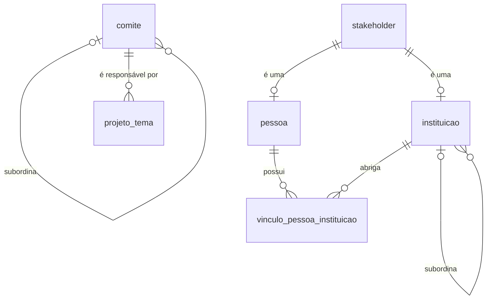
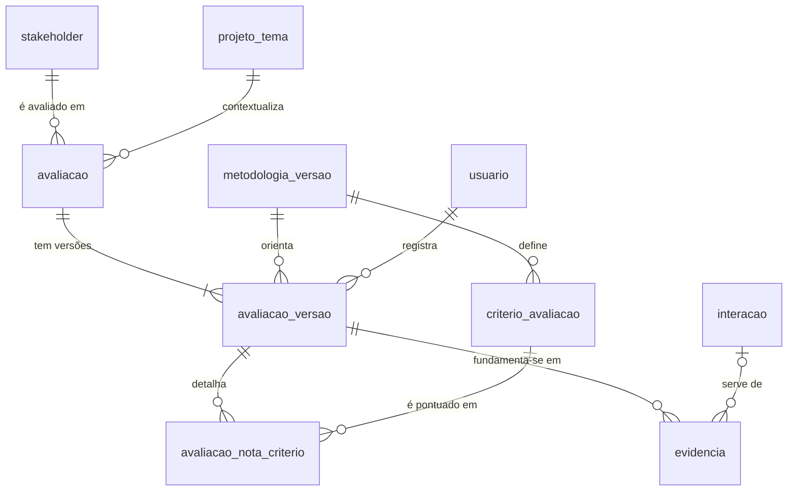
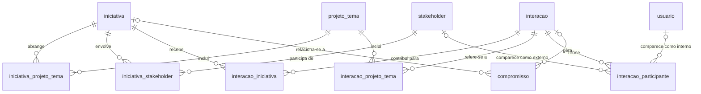
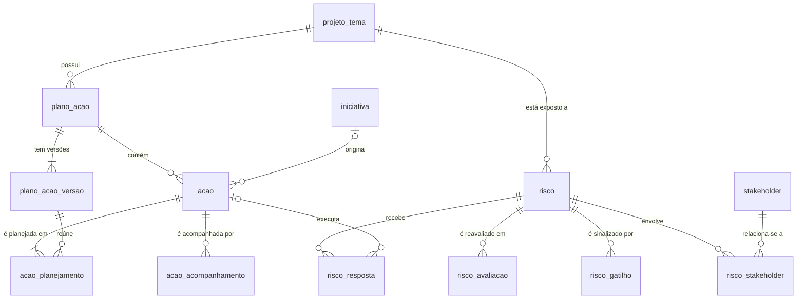
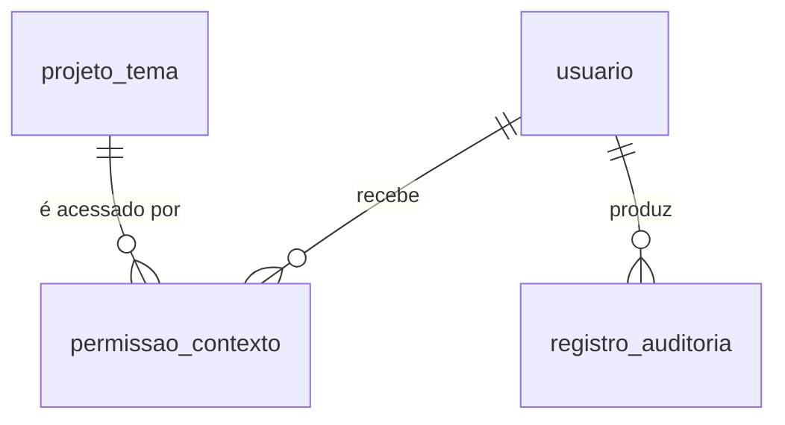

# Modelo de Dados — CRM Estratégico ES em Ação

| Versão | Data | Situação |
|---|---|---|
| 0.1 | 31/10/2026 | Modelo lógico inicial para revisão. Nenhuma tabela foi criada. |
| 0.2 | 31/10/2026 | Etapa 1: decisões D-020 e D-021 incorporadas; as 8 tabelas da seção 9 foram criadas no banco de desenvolvimento. |

Legenda: ✅ Aprovado · 🔧 Proposta técnica · ⏳ Pendente (ver [REQUISITOS.md](REQUISITOS.md#como-ler-este-documento)).

## 1. Para quem não é da área técnica

Um banco de dados relacional organiza as informações em **tabelas**, como planilhas. Cada tabela guarda um tipo de coisa (pessoas, instituições, reuniões) e cada linha é um registro.

- **Chave primária (PK)**: o "número de identidade" de cada linha. Nunca se repete e nunca muda.
- **Chave estrangeira (FK)**: um campo que aponta para a chave primária de outra tabela. É assim que uma reunião "sabe" quais pessoas participaram, sem copiar os dados dessas pessoas.
- **Cardinalidade**: quantos registros de um lado se ligam a quantos do outro. "1:N" (um para muitos) significa, por exemplo, que um comitê tem muitos projetos, mas cada projeto tem um comitê responsável. "N:N" (muitos para muitos) significa que uma iniciativa envolve vários stakeholders e cada stakeholder participa de várias iniciativas; nesse caso usa-se uma **tabela de ligação**.
- **Regra de integridade**: uma restrição que o próprio banco de dados garante, impedindo dados incoerentes (por exemplo, um prazo final anterior ao inicial).

Os diagramas abaixo são desenhados automaticamente pelo GitHub. Nos diagramas, `||` significa "exatamente um", `o|` "zero ou um", `o{` "zero ou mais" e `|{` "um ou mais".

## 2. Princípios do modelo

| # | Princípio | Situação |
|---|---|---|
| P1 | O Cadastro Mestre é global: cada pessoa e cada instituição existe uma única vez. | ✅ |
| P2 | Pessoas e instituições são cadastros separados, ligados por vínculos com período. | ✅ |
| P3 | Avaliações pertencem a um par **stakeholder × projeto/tema**, são independentes entre si e versionadas. | ✅ |
| P4 | A visibilidade das avaliações (e dos demais registros de contexto) é definida pelo projeto/tema. | ✅ |
| P5 | Cada reunião é registrada uma única vez (`interacao`) e ligada a quantas iniciativas, projetos e participantes forem necessários. | ✅ |
| P6 | Critérios de poder e interesse ficam em tabelas configuráveis, sem conteúdo definido até a revisão dos seis critérios históricos. | ✅ (estrutura 🔧) |
| P7 | "Stakeholder" é um conceito único que engloba pessoa e instituição (tabela-mãe `stakeholder`), para que avaliações, iniciativas e interações apontem para um único lugar. | 🔧 |
| P8 | Versões registradas não são editadas; mudanças geram nova versão. | 🔧 |
| P9 | Registros não são apagados fisicamente: são arquivados (`arquivado_em`). Toda alteração fica em trilha de auditoria. | 🔧 |
| P10 | Chaves primárias do tipo UUID (identificador aleatório de 128 bits), compatível com Supabase e com integrações futuras. | 🔧 |
| P11 | Nomes de tabelas e campos em português, sem acentos, em minúsculas e com sublinhado (`snake_case`). | 🔧 |

## 3. Visão geral por áreas

| Área | Tabelas |
|---|---|
| Estrutura institucional | `comite`, `projeto_tema` |
| Cadastro Mestre | `stakeholder`, `pessoa`, `instituicao`, `vinculo_pessoa_instituicao` |
| Avaliações | `metodologia_versao`, `criterio_avaliacao`, `avaliacao`, `avaliacao_versao`, `avaliacao_nota_criterio`, `evidencia` |
| Iniciativas | `iniciativa`, `iniciativa_projeto_tema`, `iniciativa_stakeholder` |
| Interações e compromissos | `interacao`, `interacao_participante`, `interacao_iniciativa`, `interacao_projeto_tema`, `compromisso` |
| Plano de ação | `plano_acao`, `plano_acao_versao`, `acao`, `acao_planejamento`, `acao_acompanhamento` |
| Riscos | `risco`, `risco_avaliacao`, `risco_gatilho`, `risco_resposta`, `risco_stakeholder` |
| Acesso e auditoria | `usuario`, `permissao_contexto`, `registro_auditoria` |

## 4. Diagramas

### 4.1 Estrutura institucional e Cadastro Mestre

### 4.2 Avaliações de stakeholders

### 4.3 Iniciativas, interações e compromissos

### 4.4 Plano de ação e riscos

### 4.5 Acesso

## 5. Campos comuns 🔧

Salvo indicação em contrário, toda tabela principal possui os campos abaixo, que não são repetidos nas seções seguintes.

| Campo | Tipo | Regra |
|---|---|---|
| `id` | UUID | PK, gerado automaticamente |
| `criado_em` | data e hora com fuso | Obrigatório, preenchido automaticamente |
| `criado_por` | UUID | FK → `usuario.id` |
| `atualizado_em` | data e hora com fuso | Atualizado automaticamente a cada alteração |
| `atualizado_por` | UUID | FK → `usuario.id` |
| `arquivado_em` | data e hora com fuso | Nulo enquanto ativo; preenchido ao arquivar |

Tabelas de versão (`avaliacao_versao`, `plano_acao_versao`, `risco_avaliacao`) e tabelas de ligação não têm `atualizado_*` nem `arquivado_em`, pois não são editadas: são incluídas ou, no caso das ligações, removidas com registro na auditoria.

## 6. Entidades

Convenções das tabelas: **PK** = chave primária; **FK** = chave estrangeira; **UK** = valor único; **Obr.** = preenchimento obrigatório.

### 6.1 Estrutura institucional

#### `comite`

Comitês do ES em Ação. ✅ (estrutura) / 🔧 (campos)

| Campo | Tipo | Chave | Obr. | Observação |
|---|---|---|---|---|
| `nome` | texto | UK | Sim | Ex.: "Comitê Temático de Inovação" |
| `sigla` | texto | UK | Não | |
| `tipo` | lista: `desenvolvimento`, `tematico` | | Sim | |
| `comite_superior_id` | UUID | FK → `comite.id` | Não | Comitê ao qual está subordinado |

Cardinalidade: um comitê subordina zero ou mais comitês (1:N, autorrelacionamento).

Regras de integridade:
- Comitê `tematico` deve ter `comite_superior_id` apontando para um comitê `desenvolvimento`. ✅ (subordinação ao Comitê de Desenvolvimento)
- Comitê `desenvolvimento` não tem comitê superior. 🔧
- Um comitê não pode ser superior de si mesmo. 🔧

Carga inicial prevista (quando o banco for criado): Comitê de Desenvolvimento; Comitês Temáticos de Infraestrutura, de Atração de Investimentos e de Inovação. ✅

#### `projeto_tema`

Projetos e temas estratégicos, que são os **contextos** das avaliações e das permissões. Projetos e temas ficam na mesma tabela, diferenciados pelo campo `tipo`, para que avaliações e permissões apontem para um único lugar. 🔧

| Campo | Tipo | Chave | Obr. | Observação |
|---|---|---|---|---|
| `tipo` | lista: `projeto`, `tema` | | Sim | |
| `nome` | texto | | Sim | |
| `descricao` | texto longo | | Não | |
| `comite_id` | UUID | FK → `comite.id` | Sim | Único comitê responsável ✅ (D-020) |
| `situacao` | lista | | Sim | Proposta: `proposto`, `ativo`, `suspenso`, `concluido` 🔧 |
| `data_inicio`, `data_fim` | data | | Não | |
| `responsavel_id` | UUID | FK → `usuario.id` | Não | |

Cardinalidades: comitê 1:N projeto_tema; projeto_tema 1:N avaliações, planos, riscos e permissões; projeto_tema N:N iniciativas e interações.

Regras de integridade:
- UK (`comite_id`, `tipo`, `nome`): não repetir nome de projeto ou tema no mesmo comitê. 🔧
- `data_fim` ≥ `data_inicio`. 🔧
- Cada projeto ou tema tem um único comitê responsável, e não há hierarquia entre temas e projetos. ✅ (D-020) Se no futuro isso mudar, cria-se uma tabela de ligação `projeto_tema_comite`, sem perda de dados.

### 6.2 Cadastro Mestre ✅ (global; pessoas e instituições separadas)

#### `stakeholder` 🔧

Tabela-mãe que dá a cada pessoa e a cada instituição um identificador comum. Avaliações, iniciativas, interações e riscos apontam para `stakeholder`, sem precisar saber se é pessoa ou instituição.

| Campo | Tipo | Chave | Obr. | Observação |
|---|---|---|---|---|
| `tipo` | lista: `pessoa`, `instituicao` | | Sim | Não pode ser alterado depois de criado |

Regras de integridade:
- Cada `stakeholder` corresponde a exatamente um registro em `pessoa` **ou** em `instituicao`, nunca aos dois, conforme o `tipo`. Garantido por chave estrangeira composta (`id`, `tipo`) nas tabelas filhas.

#### `pessoa`

| Campo | Tipo | Chave | Obr. | Observação |
|---|---|---|---|---|
| `id` | UUID | PK e FK → `stakeholder.id` | Sim | Mesmo identificador do stakeholder |
| `nome_completo` | texto | | Sim | |
| `nome_tratamento` | texto | | Não | Como prefere ser chamada |
| `email` | texto | UK quando preenchido | Não | |
| `telefone` | texto | | Não | |
| `observacoes` | texto longo | | Não | |
| `nome_normalizado` | texto | | Sim | Campo técnico: nome sem acentos e em minúsculas, usado na busca e no alerta de duplicidade 🔧 |

Somente dados mínimos. ✅ (D-021) Dados pessoais adicionais (CPF, data de nascimento, endereço) **não** são registrados. A análise LGPD (Q-13) continua necessária antes do uso de dados reais.

#### `instituicao`

| Campo | Tipo | Chave | Obr. | Observação |
|---|---|---|---|---|
| `id` | UUID | PK e FK → `stakeholder.id` | Sim | |
| `nome` | texto | | Sim | |
| `sigla` | texto | | Não | |
| `natureza` | lista | | Sim | Proposta: órgão público, empresa, entidade de classe, academia, terceiro setor, imprensa, outra 🔧 ⏳ |
| `esfera` | lista: `federal`, `estadual`, `municipal`, `nao_se_aplica` | | Não | |
| `cnpj` | texto (14 caracteres) | UK quando preenchido | Não | Numérico ou alfanumérico (formato da Receita Federal desde julho de 2026) |
| `nome_normalizado` | texto | | Sim | Campo técnico para busca e duplicidade 🔧 |
| `uf`, `municipio` | texto | | Não | |
| `site` | texto | | Não | |
| `instituicao_superior_id` | UUID | FK → `instituicao.id` | Não | Ex.: secretaria → governo estadual |

Regras: CNPJ com 14 dígitos e dígitos verificadores válidos; instituição não pode ser superior de si mesma. 🔧

#### `vinculo_pessoa_instituicao`

Liga pessoas a instituições, com cargo e período. É a forma de manter o histórico: quando alguém muda de cargo ou de instituição, o vínculo anterior recebe data de término e um novo vínculo é criado. ✅ (vínculos e histórico)

| Campo | Tipo | Chave | Obr. | Observação |
|---|---|---|---|---|
| `pessoa_id` | UUID | FK → `pessoa.id` | Sim | |
| `instituicao_id` | UUID | FK → `instituicao.id` | Sim | |
| `cargo` | texto | | Não | |
| `area` | texto | | Não | Setor ou unidade |
| `data_inicio` | data | | Não | |
| `data_fim` | data | | Não | Nulo = vínculo vigente |
| `principal` | sim/não | | Sim | Vínculo principal da pessoa |

Cardinalidade: pessoa N:N instituição (por meio desta tabela).

Regras de integridade:
- `data_fim` ≥ `data_inicio`. 🔧
- No máximo um vínculo **principal e vigente** por pessoa. 🔧
- Vínculos não são excluídos; são encerrados com `data_fim`. 🔧

### 6.3 Avaliações de stakeholders ✅ (independentes, versionadas, com visibilidade por contexto)

#### `metodologia_versao` 🔧

Registra cada versão da metodologia de avaliação. Permite revisar critérios no futuro sem invalidar avaliações antigas: cada versão de avaliação guarda a metodologia com que foi feita.

| Campo | Tipo | Chave | Obr. | Observação |
|---|---|---|---|---|
| `nome` | texto | UK | Sim | Ex.: "Metodologia provisória 0.1" |
| `descricao` | texto longo | | Não | |
| `vigente_desde`, `vigente_ate` | data | | Não | |
| `situacao` | lista: `rascunho`, `vigente`, `encerrada` | | Sim | |

Regra: no máximo uma metodologia `vigente` por vez. 🔧

#### `criterio_avaliacao` 🔧 (estrutura) / ⏳ (conteúdo)

Critérios de poder e de interesse. **A tabela nasce vazia**: os seis critérios históricos estão em revisão e nenhum critério, escala ou peso será definido antes da deliberação. ✅

| Campo | Tipo | Chave | Obr. | Observação |
|---|---|---|---|---|
| `metodologia_versao_id` | UUID | FK → `metodologia_versao.id` | Sim | |
| `dimensao` | lista: `poder`, `interesse` | | Sim | |
| `nome` | texto | | Sim | |
| `descricao` | texto longo | | Não | Orientação para o avaliador |
| `escala_minima`, `escala_maxima` | número inteiro | | Sim | ⏳ |
| `peso` | número decimal | | Não | ⏳ |
| `ordem` | número inteiro | | Sim | Ordem de exibição |

Regras: UK (`metodologia_versao_id`, `dimensao`, `nome`); `escala_maxima` > `escala_minima`; critérios de metodologia `vigente` ou `encerrada` não podem ser alterados. 🔧

#### `avaliacao`

"Ficha" que reúne o histórico de avaliações de **um** stakeholder em **um** projeto ou tema.

| Campo | Tipo | Chave | Obr. | Observação |
|---|---|---|---|---|
| `stakeholder_id` | UUID | FK → `stakeholder.id` | Sim | |
| `projeto_tema_id` | UUID | FK → `projeto_tema.id` | Sim | Define a visibilidade ✅ |

Cardinalidades: stakeholder 1:N avaliação; projeto_tema 1:N avaliação; avaliação 1:N versões (pelo menos uma).

Regras de integridade:
- UK (`stakeholder_id`, `projeto_tema_id`): um stakeholder tem uma única ficha por contexto; as reavaliações entram como versões. 🔧
- A avaliação de um contexto não lê nem altera dados de outro contexto. ✅

#### `avaliacao_versao`

Cada linha é uma avaliação completa feita em determinada data. Não é editada depois de registrada.

| Campo | Tipo | Chave | Obr. | Observação |
|---|---|---|---|---|
| `avaliacao_id` | UUID | FK → `avaliacao.id` | Sim | |
| `numero_versao` | número inteiro | | Sim | 1, 2, 3… |
| `metodologia_versao_id` | UUID | FK → `metodologia_versao.id` | Não | Nulo enquanto não houver metodologia aprovada |
| `poder` | número decimal | | Não | Resultado consolidado; escala ⏳ |
| `interesse` | número decimal | | Não | Resultado consolidado; escala ⏳ |
| `posicionamento` | lista | | Não | Categorias ⏳ (ver [METODOLOGIA_STAKEHOLDERS.md](METODOLOGIA_STAKEHOLDERS.md)) |
| `grau_confianca` | lista | | Não | Significado e categorias ⏳ |
| `justificativa` | texto longo | | Sim | ✅ |
| `data_referencia` | data | | Sim | Data a que a avaliação se refere |
| `situacao` | lista: `vigente`, `substituida` | | Sim | |
| `avaliador_id` | UUID | FK → `usuario.id` | Sim | |

Regras de integridade:
- UK (`avaliacao_id`, `numero_versao`). 🔧
- Exatamente uma versão `vigente` por avaliação; ao registrar nova versão, a anterior passa a `substituida` na mesma operação. 🔧
- Versões registradas não podem ser alteradas nem excluídas. 🔧
- Se `metodologia_versao_id` estiver preenchido, `poder` e `interesse` devem respeitar as escalas daquela metodologia. 🔧

#### `avaliacao_nota_criterio` 🔧

Nota atribuída a cada critério numa versão de avaliação. Só será usada depois que os critérios forem aprovados.

| Campo | Tipo | Chave | Obr. | Observação |
|---|---|---|---|---|
| `avaliacao_versao_id` | UUID | FK → `avaliacao_versao.id` | Sim | |
| `criterio_avaliacao_id` | UUID | FK → `criterio_avaliacao.id` | Sim | |
| `nota` | número decimal | | Sim | Dentro da escala do critério |
| `justificativa` | texto longo | | Não | |

Regras: PK composta (`avaliacao_versao_id`, `criterio_avaliacao_id`); o critério deve pertencer à mesma metodologia da versão de avaliação.

#### `evidencia`

Fundamentos de uma versão de avaliação. Uma evidência pode apontar para uma interação já registrada, em vez de repetir seu conteúdo. ✅ (evidências) / 🔧 (estrutura)

| Campo | Tipo | Chave | Obr. | Observação |
|---|---|---|---|---|
| `avaliacao_versao_id` | UUID | FK → `avaliacao_versao.id` | Sim | |
| `tipo` | lista: `documento`, `link`, `interacao`, `observacao` | | Sim | |
| `descricao` | texto longo | | Sim | |
| `url` | texto | | Não | Link externo (futuramente SharePoint/OneDrive) |
| `interacao_id` | UUID | FK → `interacao.id` | Não | Obrigatório quando `tipo` = `interacao` |
| `data_evidencia` | data | | Não | |

### 6.4 Iniciativas ✅ (cadastro manual; vários stakeholders e projetos)

#### `iniciativa`

| Campo | Tipo | Chave | Obr. | Observação |
|---|---|---|---|---|
| `tipo` | lista: `demanda`, `reuniao_relevante`, `frente_atuacao` | | Sim | ✅ |
| `titulo` | texto | | Sim | |
| `descricao` | texto longo | | Não | |
| `origem` | texto | | Não | Quem ou o que originou |
| `situacao` | lista | | Sim | Proposta em [MATRIZ_INICIATIVAS.md](MATRIZ_INICIATIVAS.md) 🔧 |
| `prioridade` | lista | | Não | ⏳ |
| `responsavel_id` | UUID | FK → `usuario.id` | Não | |
| `data_abertura` | data | | Sim | |
| `data_prevista_conclusao`, `data_conclusao` | data | | Não | |

Regras: `data_conclusao` ≥ `data_abertura`; situação `concluida` exige `data_conclusao`. 🔧

Uma iniciativa do tipo `reuniao_relevante` **não guarda os dados da reunião**: data, local, participantes e registro ficam na `interacao` ligada a ela por `interacao_iniciativa`. Isso evita duplicar reuniões. 🔧 ⏳ (interpretação a validar)

#### `iniciativa_projeto_tema` (ligação N:N)

| Campo | Tipo | Chave | Obr. |
|---|---|---|---|
| `iniciativa_id` | UUID | PK composta, FK → `iniciativa.id` | Sim |
| `projeto_tema_id` | UUID | PK composta, FK → `projeto_tema.id` | Sim |

Regra: toda iniciativa deve estar ligada a pelo menos um projeto ou tema, para que tenha contexto de visibilidade. 🔧 ⏳

#### `iniciativa_stakeholder` (ligação N:N)

| Campo | Tipo | Chave | Obr. | Observação |
|---|---|---|---|---|
| `iniciativa_id` | UUID | PK composta, FK → `iniciativa.id` | Sim | |
| `stakeholder_id` | UUID | PK composta, FK → `stakeholder.id` | Sim | |
| `papel` | lista | PK composta | Sim | Proposta: `demandante`, `apoiador`, `decisor`, `executor`, `afetado`, `outro` 🔧 |
| `observacao` | texto | | Não | |

A inclusão de `papel` na chave permite que o mesmo stakeholder tenha mais de um papel na mesma iniciativa.

### 6.5 Interações e compromissos ✅ (reunião registrada uma única vez)

#### `interacao`

Reuniões, contatos e demais encontros.

| Campo | Tipo | Chave | Obr. | Observação |
|---|---|---|---|---|
| `tipo` | lista | | Sim | Proposta: `reuniao_presencial`, `reuniao_virtual`, `ligacao`, `email`, `evento`, `visita`, `outro` 🔧 |
| `assunto` | texto | | Sim | |
| `inicio` | data e hora | | Sim | |
| `fim` | data e hora | | Não | |
| `local` | texto | | Não | Endereço ou link da reunião virtual |
| `resumo` | texto longo | | Não | Registro ou ata resumida |
| `situacao` | lista: `agendada`, `realizada`, `cancelada` | | Sim | |
| `origem_sistema` | texto | | Não | Ex.: `outlook` (integração futura) |
| `origem_id` | texto | | Não | Identificador do evento no sistema de origem |

Regras de integridade:
- `fim` ≥ `inicio`. 🔧
- UK (`origem_sistema`, `origem_id`) quando preenchidos: a mesma reunião do calendário nunca é importada duas vezes. ✅ (não duplicar) / 🔧 (mecanismo)
- Alerta de possível duplicidade ao cadastrar manualmente interação com mesmo assunto e horário próximo. 🔧

#### `interacao_participante`

| Campo | Tipo | Chave | Obr. | Observação |
|---|---|---|---|---|
| `interacao_id` | UUID | FK → `interacao.id` | Sim | |
| `stakeholder_id` | UUID | FK → `stakeholder.id` | Não | Participante externo |
| `usuario_id` | UUID | FK → `usuario.id` | Não | Participante da equipe interna |
| `presenca` | lista: `convidado`, `presente`, `ausente` | | Sim | |

Regras: exatamente um entre `stakeholder_id` e `usuario_id` preenchido; UK (`interacao_id`, `stakeholder_id`) e UK (`interacao_id`, `usuario_id`). 🔧

#### `interacao_iniciativa` (ligação N:N) ✅

Uma interação pode contribuir para uma ou mais iniciativas; uma iniciativa recebe várias interações.

| Campo | Tipo | Chave | Obr. | Observação |
|---|---|---|---|---|
| `interacao_id` | UUID | PK composta, FK → `interacao.id` | Sim | |
| `iniciativa_id` | UUID | PK composta, FK → `iniciativa.id` | Sim | |
| `contribuicao` | texto | | Não | Como a interação contribuiu para a iniciativa |

#### `interacao_projeto_tema` (ligação N:N) 🔧

Liga a interação diretamente a projetos ou temas. É necessária para interações que ainda não pertencem a nenhuma iniciativa e define quem pode vê-las.

| Campo | Tipo | Chave | Obr. |
|---|---|---|---|
| `interacao_id` | UUID | PK composta, FK → `interacao.id` | Sim |
| `projeto_tema_id` | UUID | PK composta, FK → `projeto_tema.id` | Sim |

#### `compromisso`

Encaminhamentos e prazos. ✅

| Campo | Tipo | Chave | Obr. | Observação |
|---|---|---|---|---|
| `descricao` | texto longo | | Sim | |
| `interacao_id` | UUID | FK → `interacao.id` | Não | Interação que gerou o compromisso |
| `iniciativa_id` | UUID | FK → `iniciativa.id` | Não | |
| `responsavel_usuario_id` | UUID | FK → `usuario.id` | Não | Responsável interno |
| `responsavel_stakeholder_id` | UUID | FK → `stakeholder.id` | Não | Responsável externo |
| `prazo` | data | | Não | |
| `situacao` | lista: `aberto`, `em_andamento`, `concluido`, `cancelado` | | Sim | "Atrasado" é calculado (prazo vencido e não concluído) |
| `concluido_em` | data | | Não | |
| `acao_id` | UUID | FK → `acao.id` | Não | Quando o compromisso vira ação do plano 🔧 |

Regras: ao menos um entre `interacao_id` e `iniciativa_id`; ao menos um responsável; situação `concluido` exige `concluido_em`. 🔧

### 6.6 Plano de ação ✅ (ações, responsáveis, marcos, versões e aprovação)

O detalhamento do fluxo está em [PLANO_ACAO.md](PLANO_ACAO.md).

#### `plano_acao`

| Campo | Tipo | Chave | Obr. | Observação |
|---|---|---|---|---|
| `projeto_tema_id` | UUID | FK → `projeto_tema.id` | Sim | Contexto e visibilidade |
| `titulo` | texto | | Sim | |
| `objetivo` | texto longo | | Não | |
| `responsavel_id` | UUID | FK → `usuario.id` | Não | |

Cardinalidade: projeto_tema 1:N plano_acao. ⏳ Confirmar se há um único plano por projeto/tema.

#### `plano_acao_versao`

| Campo | Tipo | Chave | Obr. | Observação |
|---|---|---|---|---|
| `plano_acao_id` | UUID | FK → `plano_acao.id` | Sim | |
| `numero_versao` | número inteiro | | Sim | |
| `situacao` | lista: `rascunho`, `em_aprovacao`, `aprovada`, `rejeitada`, `substituida` | | Sim | |
| `motivo_alteracao` | texto longo | | Sim a partir da versão 2 | |
| `proposta_por`, `proposta_em` | UUID / data e hora | FK → `usuario.id` | Sim | |
| `decidida_por`, `decidida_em` | UUID / data e hora | FK → `usuario.id` | Não | Obrigatórios em `aprovada` e `rejeitada` |
| `parecer` | texto longo | | Não | |

Regras de integridade:
- UK (`plano_acao_id`, `numero_versao`). 🔧
- No máximo uma versão `aprovada` (vigente) e uma em `rascunho`/`em_aprovacao` por plano. 🔧
- Ao aprovar uma nova versão, a anterior passa a `substituida`. 🔧
- Versões `aprovada`, `rejeitada` e `substituida` não podem ser alteradas. 🔧

#### `acao`

Identidade permanente de uma ação ou marco, que atravessa as versões do plano.

| Campo | Tipo | Chave | Obr. | Observação |
|---|---|---|---|---|
| `plano_acao_id` | UUID | FK → `plano_acao.id` | Sim | |
| `codigo` | texto | | Sim | Ex.: "A-01", "M-01" |
| `tipo` | lista: `acao`, `marco` | | Sim | Marco = ponto de verificação com data única ✅ |
| `iniciativa_id` | UUID | FK → `iniciativa.id` | Não | Iniciativa que originou a ação |

Regra: UK (`plano_acao_id`, `codigo`).

#### `acao_planejamento`

O que foi planejado para a ação **em cada versão** do plano. Cada versão do plano é uma "fotografia" completa das ações planejadas.

| Campo | Tipo | Chave | Obr. | Observação |
|---|---|---|---|---|
| `acao_id` | UUID | FK → `acao.id` | Sim | |
| `plano_acao_versao_id` | UUID | FK → `plano_acao_versao.id` | Sim | |
| `titulo` | texto | | Sim | |
| `descricao` | texto longo | | Não | |
| `responsavel_usuario_id` | UUID | FK → `usuario.id` | Não | |
| `responsavel_stakeholder_id` | UUID | FK → `stakeholder.id` | Não | Responsável externo, quando houver |
| `inicio_previsto`, `fim_previsto` | data | | Não | Marco: apenas `fim_previsto` |

Regras: UK (`acao_id`, `plano_acao_versao_id`); `fim_previsto` ≥ `inicio_previsto`; a ação e a versão devem pertencer ao mesmo plano; ao menos um responsável. 🔧

#### `acao_acompanhamento`

Registros de andamento. Não exigem aprovação. 🔧

| Campo | Tipo | Chave | Obr. | Observação |
|---|---|---|---|---|
| `acao_id` | UUID | FK → `acao.id` | Sim | |
| `data_registro` | data | | Sim | |
| `situacao` | lista: `nao_iniciada`, `em_andamento`, `concluida`, `suspensa`, `cancelada` | | Sim | |
| `percentual` | número inteiro 0–100 | | Não | |
| `comentario` | texto longo | | Não | |

### 6.7 Riscos ✅ (criticidade, gatilhos e medidas de resposta)

O detalhamento está em [MATRIZ_RISCOS.md](MATRIZ_RISCOS.md).

#### `risco`

| Campo | Tipo | Chave | Obr. | Observação |
|---|---|---|---|---|
| `projeto_tema_id` | UUID | FK → `projeto_tema.id` | Sim | Contexto e visibilidade |
| `iniciativa_id` | UUID | FK → `iniciativa.id` | Não | |
| `codigo` | texto | | Sim | Ex.: "R-01" |
| `titulo` | texto | | Sim | |
| `descricao`, `causa`, `consequencia` | texto longo | | Não | |
| `categoria` | lista | | Não | ⏳ |
| `responsavel_id` | UUID | FK → `usuario.id` | Não | |
| `situacao` | lista: `identificado`, `em_monitoramento`, `materializado`, `encerrado` | | Sim | 🔧 |

Regra: UK (`projeto_tema_id`, `codigo`).

#### `risco_avaliacao`

Histórico de avaliações do risco; a mais recente é a vigente. Não é editada.

| Campo | Tipo | Chave | Obr. | Observação |
|---|---|---|---|---|
| `risco_id` | UUID | FK → `risco.id` | Sim | |
| `data_avaliacao` | data | | Sim | |
| `probabilidade` | número inteiro | | Sim | Escala ⏳ |
| `impacto` | número inteiro | | Sim | Escala ⏳ |
| `criticidade` | número | | Sim | Calculada pelo banco (fórmula ⏳) |
| `justificativa` | texto longo | | Não | |
| `avaliado_por` | UUID | FK → `usuario.id` | Sim | |

#### `risco_gatilho`

| Campo | Tipo | Chave | Obr. | Observação |
|---|---|---|---|---|
| `risco_id` | UUID | FK → `risco.id` | Sim | |
| `descricao` | texto longo | | Sim | Sinal que indica que o risco está se aproximando |
| `ativo` | sim/não | | Sim | |

#### `risco_resposta`

| Campo | Tipo | Chave | Obr. | Observação |
|---|---|---|---|---|
| `risco_id` | UUID | FK → `risco.id` | Sim | |
| `estrategia` | lista: `evitar`, `mitigar`, `transferir`, `aceitar` | | Sim | 🔧 |
| `descricao` | texto longo | | Sim | |
| `responsavel_id` | UUID | FK → `usuario.id` | Não | |
| `prazo` | data | | Não | |
| `situacao` | lista: `planejada`, `em_execucao`, `concluida`, `cancelada` | | Sim | |
| `acao_id` | UUID | FK → `acao.id` | Não | Evita duplicar medidas que já estão no plano de ação |

#### `risco_stakeholder` (ligação N:N) 🔧

| Campo | Tipo | Chave | Obr. |
|---|---|---|---|
| `risco_id` | UUID | PK composta, FK → `risco.id` | Sim |
| `stakeholder_id` | UUID | PK composta, FK → `stakeholder.id` | Sim |
| `observacao` | texto | | Não |

### 6.8 Acesso e auditoria

#### `usuario`

| Campo | Tipo | Chave | Obr. | Observação |
|---|---|---|---|---|
| `id` | UUID | PK | Sim | Será o identificador do Supabase Auth ✅ (quando configurado) |
| `nome` | texto | | Sim | |
| `email` | texto | UK | Sim | |
| `administrador` | sim/não | | Sim | Inicialmente, um único administrador ✅ |
| `situacao` | lista: `ativo`, `inativo` | | Sim | |

#### `permissao_contexto` ✅ (permissões por projeto ou tema)

| Campo | Tipo | Chave | Obr. | Observação |
|---|---|---|---|---|
| `usuario_id` | UUID | FK → `usuario.id` | Sim | |
| `projeto_tema_id` | UUID | FK → `projeto_tema.id` | Sim | |
| `perfil` | lista: `gestor`, `colaborador`, `leitor` | | Sim | 🔧 ⏳ |
| `concedida_por` | UUID | FK → `usuario.id` | Sim | |
| `valida_ate` | data | | Não | |

Regra: UK (`usuario_id`, `projeto_tema_id`).

#### `registro_auditoria` 🔧

Preenchida automaticamente pelo banco a cada inclusão, alteração ou arquivamento. Não pode ser alterada nem excluída por nenhum usuário.

| Campo | Tipo | Observação |
|---|---|---|
| `id` | número sequencial | PK |
| `tabela` | texto | |
| `registro_id` | UUID | |
| `operacao` | lista: `inclusao`, `alteracao`, `arquivamento`, `reativacao`, `exclusao` | |
| `dados_anteriores`, `dados_novos` | JSON | |
| `usuario_id` | UUID | FK → `usuario.id` |
| `ocorrido_em` | data e hora com fuso | |

## 7. Regras de visibilidade 🔧 (implementação de ✅ RN-03 e RU-02)

A segurança será aplicada no próprio banco de dados (PostgreSQL Row Level Security, recurso nativo do Supabase), e não apenas nas telas.

| Registro | Quem pode ver |
|---|---|
| Comitês, Cadastro Mestre (pessoas, instituições, vínculos) | Todos os usuários ativos ⏳ |
| Avaliações e suas versões, notas e evidências | Administrador e usuários com permissão no `projeto_tema` da avaliação |
| Iniciativas | Usuários com permissão em pelo menos um dos projetos/temas ligados |
| Interações e compromissos | Usuários com permissão em algum projeto/tema ligado à interação, diretamente ou por meio de suas iniciativas |
| Planos de ação e riscos | Usuários com permissão no `projeto_tema` do plano ou risco |
| Auditoria | Somente administrador |

Enquanto houver um único administrador, ele vê tudo; as regras acima passam a ter efeito quando novos usuários forem incluídos.

## 8. Questões de modelagem pendentes ⏳

1. Escalas de poder e interesse, os seis critérios e seus pesos.
2. Categorias de posicionamento e significado de "grau de confiança".
3. Um único plano de ação por projeto/tema ou vários?
4. Escalas de probabilidade e impacto e fórmula de criticidade.
5. Visibilidade do Cadastro Mestre para todos os usuários.
6. Análise LGPD dos dados pessoais registrados.

Resolvidas na Etapa 1: comitê por projeto/tema e hierarquia (D-020); dados mínimos de pessoas (D-021). As decisões são acompanhadas em [REGISTRO_DECISOES.md](REGISTRO_DECISOES.md).

## 9. Situação da implementação

| Tabela | Etapa | Situação |
|---|---|---|
| `usuario`, `registro_auditoria` | 1 | Criadas no banco de desenvolvimento |
| `comite` (com os 4 comitês), `projeto_tema` | 1 | Criadas; projetos e temas ainda sem telas |
| `stakeholder`, `pessoa`, `instituicao`, `vinculo_pessoa_instituicao` | 1 | Criadas, com telas do Cadastro Mestre |
| Demais tabelas | 2 a 4 | Não criadas |

Onde está cada parte:

- **Estrutura das tabelas:** `src/lib/banco/esquema.ts`.
- **Scripts SQL (migrations):** `src/lib/banco/migracoes/`.
  - `0000`: tabelas, chaves e regras;
  - `0001`: gatilhos de auditoria, de preenchimento automático e de proteção;
  - `0002`: carga dos 4 comitês.
- **Regras garantidas por gatilhos** 🔧:
  - preenchimento automático de quem criou ou alterou cada registro, e quando;
  - trilha de auditoria a cada inclusão, alteração, arquivamento e reativação, sem registrar alterações que não mudam nenhum dado;
  - proibição de excluir registros (somente arquivar) e de alterar a auditoria;
  - comitê temático subordinado apenas ao comitê de desenvolvimento;
  - hierarquia de instituições sem ciclos;
  - tipo do stakeholder imutável.

Enquanto não houver login (etapa de autenticação), todas as operações são atribuídas ao usuário fictício "Administrador (desenvolvimento)". 🔧
