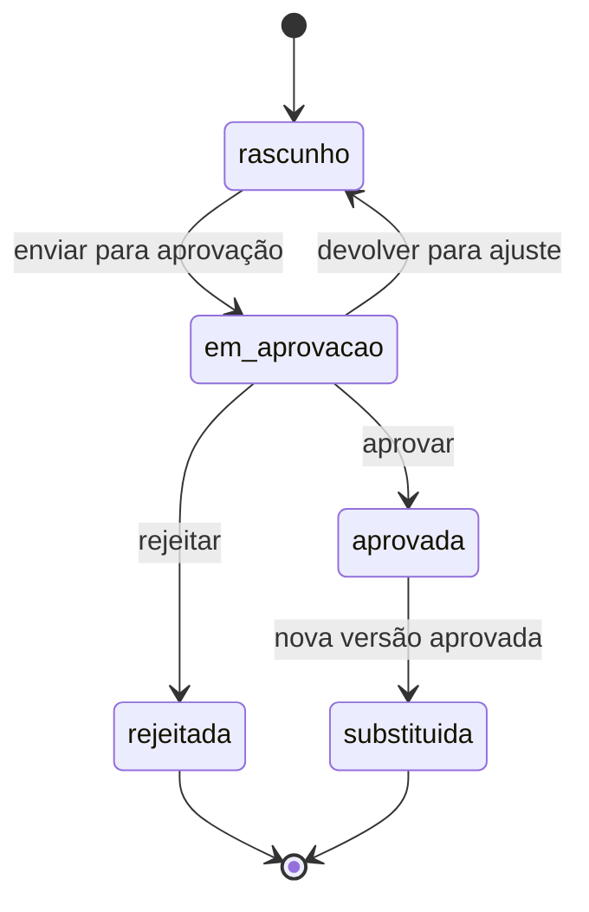

# Plano de Ação

| Versão | Data | Situação |
|---|---|---|
| 0.1 | 31/10/2026 | Rascunho para revisão |

Legenda: ✅ Aprovado · 🔧 Proposta técnica · ⏳ Pendente.

## 1. Escopo aprovado ✅

O módulo de Plano de Ação deve registrar **ações**, **responsáveis**, **marcos**, **versões** e a **aprovação de alterações**.

## 2. Conceitos

| Termo | Significado |
|---|---|
| **Plano de ação** | Conjunto organizado de ações de um projeto ou tema. 🔧 |
| **Ação** | Tarefa com responsável e prazo. ✅ |
| **Marco** | Ponto de verificação com data, sem duração (por exemplo, "audiência pública realizada"). ✅ |
| **Versão do plano** | "Fotografia" completa das ações e marcos planejados em determinado momento. ✅ (versões) / 🔧 (forma) |
| **Acompanhamento** | Registro do andamento de uma ação (situação, percentual, comentário). 🔧 |

## 3. Versões e aprovação 🔧

Cada alteração de planejamento gera uma nova versão do plano, que só entra em vigor depois de aprovada. As versões anteriores permanecem consultáveis.

Regras propostas:

1. Existe no máximo **uma versão aprovada (vigente)** e **uma versão em elaboração** por plano.
2. Versões aprovadas, rejeitadas ou substituídas **não podem ser editadas**.
3. A partir da segunda versão, é obrigatório informar o **motivo da alteração**.
4. Quem decide (aprova ou rejeita) e quando ficam registrados, com parecer opcional.
5. Cada ação tem um **código permanente** (por exemplo, A-03), para que se possa comparar como ela foi planejada em cada versão.

### O que exige nova versão e o que não exige 🔧 ⏳

| Exige nova versão aprovada | Não exige aprovação |
|---|---|
| Incluir ou retirar ação ou marco | Registrar andamento (situação, percentual) |
| Alterar prazo previsto | Incluir comentário de acompanhamento |
| Trocar responsável | Corrigir erro de digitação? ⏳ |
| Alterar descrição ou escopo da ação | |

## 4. Informações de cada ação 🔧

| Informação | Obrigatória | Observação |
|---|---|---|
| Código | Sim | Permanente entre versões |
| Tipo | Sim | Ação ou marco |
| Título e descrição | Título obrigatório | |
| Responsável | Sim (pelo menos um) | Interno (usuário) ou externo (stakeholder) |
| Início e fim previstos | Fim obrigatório para marcos | |
| Iniciativa de origem | Não | Ligação com a Matriz de Iniciativas |
| Andamento | — | Registrado à parte, com histórico |

Situações de andamento propostas: não iniciada, em andamento, concluída, suspensa, cancelada. A condição "atrasada" é calculada automaticamente (prazo vencido sem conclusão).

## 5. Relação com outros módulos 🔧

- **Compromissos** assumidos em reuniões podem ser convertidos em ações do plano, mantendo a ligação com a reunião de origem.
- **Respostas a riscos** podem apontar para uma ação do plano, em vez de duplicar a tarefa.
- **Iniciativas** podem originar ações.

## 6. Questões pendentes ⏳

| ID | Questão |
|---|---|
| Q-30 | Quem aprova alterações de plano quando houver vários usuários? (Inicialmente, o administrador único.) |
| Q-31 | Cada projeto ou tema tem um único plano de ação ou pode ter vários? |
| Q-32 | Planos de ação também podem existir por iniciativa? |
| Q-33 | A tabela "exige / não exige nova versão" (seção 3) está correta? |
| Q-34 | É necessária aprovação em mais de um nível (por exemplo, comitê temático e depois Comitê de Desenvolvimento)? |
