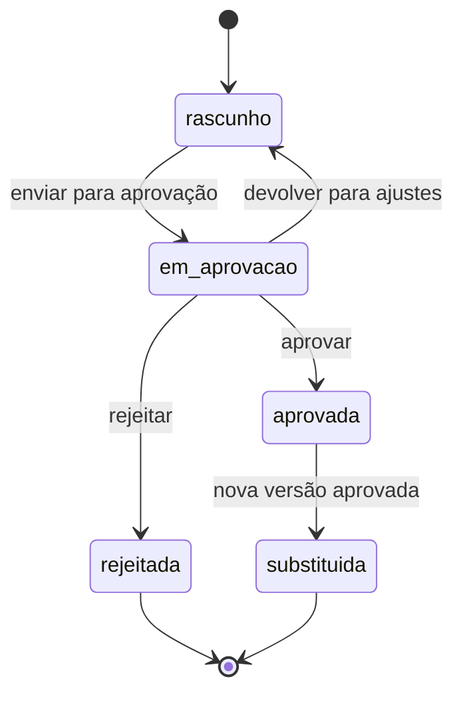

# Plano de Ação

| Versão | Data | Situação |
|---|---|---|
| 0.1 | 31/10/2026 | Rascunho para revisão |
| 0.2 | 03/11/2026 | Etapa 4 aprovada e implementada (D-072), aguardando homologação: um plano por projeto ou tema, pilares ou eixos, marcos verificáveis, versões com aprovação em nível único e acompanhamento sem aprovação; Q-30, Q-31, Q-32 e Q-34 resolvidas; Q-33 adotada provisoriamente |
| 0.3 | 04/11/2026 | Etapa 4 homologada para desenvolvimento (D-073); as soluções provisórias P-047, P-048, P-051 e P-052 continuam não homologadas |

Legenda: ✅ Aprovado · 🔧 Proposta técnica · ⏳ Pendente.

## 1. Escopo aprovado ✅

O módulo de Plano de Ação registra **ações**, **responsáveis**, **marcos**, **versões** e a **aprovação de alterações** (D-072). A estrutura reproduz o instrumento de plano de ação em uso no Comitê de Infraestrutura: ações por pilar, com justificativa, detalhamento, responsável, marcos, prazos, situação, periodicidade, stakeholders e observações.

## 2. Conceitos

| Termo | Significado |
|---|---|
| **Plano de ação** | Conjunto organizado de ações de um projeto ou tema. **Um plano por projeto ou tema** ✅ (D-072). Não há planos por iniciativa; as ações podem ligar-se a iniciativas. |
| **Pilar ou eixo** | Agrupamento das ações e dos marcos, próprio de cada projeto ou tema, com objetivo estratégico ✅ (D-072). |
| **Ação** | Tarefa com responsável e prazo, identificada por código permanente (A-01, A-02…) ✅. |
| **Marco** | Entrega ou ponto verificável de uma ação, com prazo previsto (M1, M2…) ✅. É a medida principal de evolução (D-072). |
| **Versão do plano** | "Fotografia" completa das ações e marcos planejados em determinado momento ✅. |
| **Acompanhamento** | Registro do andamento: situação, marco alcançado, observação e, de forma complementar e opcional, percentual ✅ (D-072). |

## 3. Pilares ou eixos ✅ (D-072, item 2.1)

Cada plano tem os seus pilares ou eixos. Ao criar o plano, o sistema oferece, como **modelo de referência não obrigatório**, os cinco pilares do Comitê de Infraestrutura:

| Código | Pilar |
|---|---|
| P1 | Institucional / Governança |
| P2 | Regulatório / Procedimental |
| P3 | Técnico-Estratégico |
| P4 | Operacional Indireto / Prontidão |
| P5 | Comunicação / Transparência / Licença Social |

Os pilares podem ser renomeados, arquivados ou complementados; outros comitês podem usar eixos diferentes. O objetivo estratégico de cada pilar é registrado no próprio projeto ou tema.

## 4. Versões e aprovação ✅ (D-072, itens 2.3 e D3)

Cada alteração estrutural do planejamento gera uma nova versão do plano, que só entra em vigor depois de aprovada. As versões anteriores permanecem consultáveis.

Regras, garantidas pelo banco de dados:

1. No máximo **uma versão aprovada (vigente)** e **uma versão em elaboração** (rascunho ou em aprovação) por plano.
2. Versões aprovadas, rejeitadas ou substituídas **não podem ser alteradas**; o planejamento (ações e marcos) só muda na versão em rascunho.
3. A nova versão nasce como cópia completa da vigente; a partir da segunda versão, é obrigatório informar o **motivo da alteração** no envio.
4. Só se envia para aprovação uma versão com pelo menos uma ação.
5. **Aprovação em nível único pelo administrador do sistema ou pelo gestor do projeto ou tema** (D-074, D3, que modifica a D-072). O colaborador registra, altera e envia para aprovação, mas não decide; o leitor só consulta. A regra vale no próprio banco (Etapa 5). Quem decidiu, a data e o parecer (opcional) ficam registrados na versão e no histórico do fluxo (envio, devolução, aprovação, rejeição). A estrutura permite, no futuro, outros níveis de aprovação.
6. Códigos permanentes (A-01, M1…) permitem comparar como cada ação foi planejada em cada versão; a tela da versão em aprovação mostra as diferenças em relação à vigente, campo a campo.

### O que exige nova versão e o que não exige (adotado provisoriamente — Q-33)

| Exige nova versão aprovada | Não exige aprovação |
|---|---|
| Incluir ou retirar ação ou marco | Registrar situação e percentual |
| Alterar prazo previsto | Registrar marco alcançado |
| Trocar responsável | Incluir observação de acompanhamento |
| Alterar descrição, escopo ou pilar da ação | Ligar a ação a uma iniciativa ou a stakeholders (P-051) |

Ainda em aberto: a correção de erro de digitação numa versão aprovada. Por ora, é feita por nova versão (P-051). ⏳

## 5. Informações de cada ação ✅

| Informação | Obrigatória | Observação |
|---|---|---|
| Código | Sim | Permanente entre versões (A-01, A-02…) |
| Pilar ou eixo | Não | Do próprio plano |
| Ação (título), detalhamento e justificativa | Título obrigatório | |
| Responsável | Sim (pelo menos um) | Da equipe (usuário) e/ou externo (pessoa ou instituição) |
| Início e fim previstos | Não | Fim ≥ início |
| Periodicidade de acompanhamento | Não | Mensal, bimestral, trimestral, semestral ou anual |
| Marcos | Não | Descrição e prazo previsto (P-047) |
| Iniciativa relacionada | Não | Ligação com a Matriz de Iniciativas |
| Stakeholders relacionados | Não | Pessoas e instituições do Cadastro Mestre |
| Andamento | — | Registrado à parte, com histórico preservado |

Situações de andamento: não iniciada, em andamento, concluída, suspensa e cancelada. A condição **atrasada** é calculada: prazo final vencido e ação não concluída nem cancelada (sem registro, a ação conta como não iniciada). O acompanhamento é registrado nas ações da versão vigente; os registros não são alterados (uma correção é um novo registro).

## 6. Relação com outros módulos ✅ (D-072, item 4)

- **Compromissos** podem ser convertidos em ações do plano, mantendo a ligação com a interação ou a iniciativa de origem e sem duplicidade (P-052): a ação entra na versão em rascunho e depende de aprovação; o compromisso passa a apontar para ela.
- **Respostas a riscos** podem apontar para uma ação do plano, em vez de duplicar a tarefa ([Matriz de Riscos](MATRIZ_RISCOS.md)).
- **Iniciativas** mostram as ações ligadas a elas; **pessoas e instituições**, as ações de que são responsáveis ou com que se relacionam; o **projeto ou tema**, o resumo do plano (versão vigente, ações, atrasos e marcos).

## 7. Questões ⏳

| ID | Questão | Situação |
|---|---|---|
| Q-30 | Quem aprova alterações de plano quando houver vários usuários? | ✅ Resolvida (D-074, D3): administrador ou gestor do projeto ou tema, em nível único. Antes (D-072): administrador do sistema, em nível único, até a autenticação |
| Q-31 | Cada projeto ou tema tem um único plano de ação ou pode ter vários? | ✅ Resolvida (D-072): um plano por projeto ou tema |
| Q-32 | Planos de ação também podem existir por iniciativa? | ✅ Resolvida (D-072): não; as ações ligam-se a iniciativas |
| Q-33 | A tabela "exige / não exige nova versão" (seção 4) está correta? | Adotada provisoriamente (D-072); falta decidir a correção de erro de digitação ⏳ |
| Q-34 | É necessária aprovação em mais de um nível? | ✅ Resolvida por ora (D-072): nível único, com estrutura preparada para governança futura |
